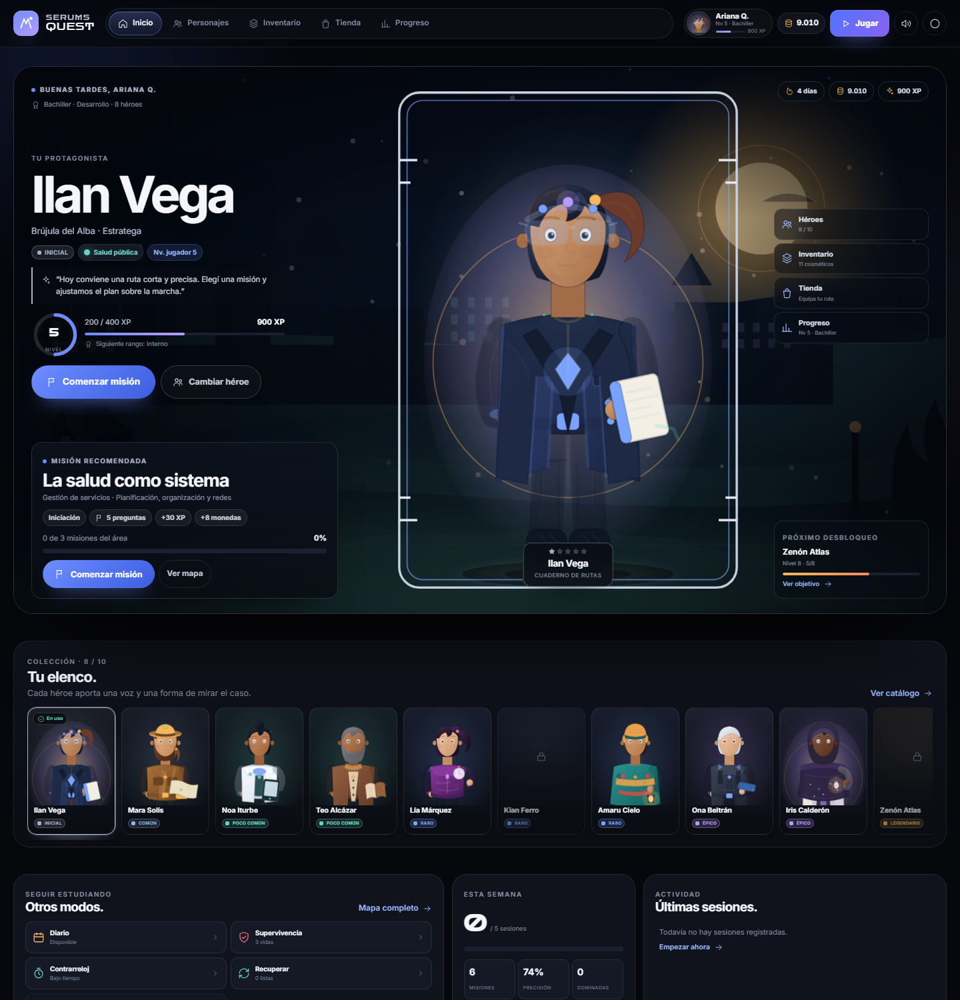
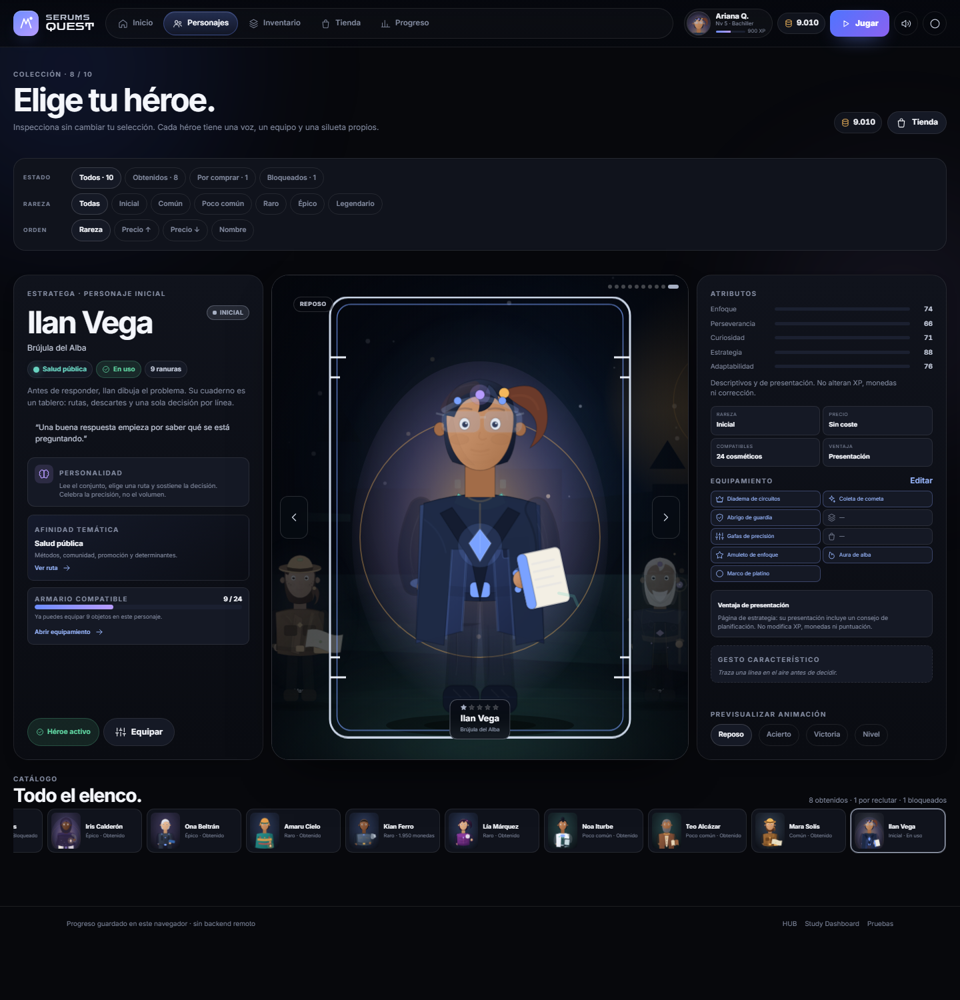
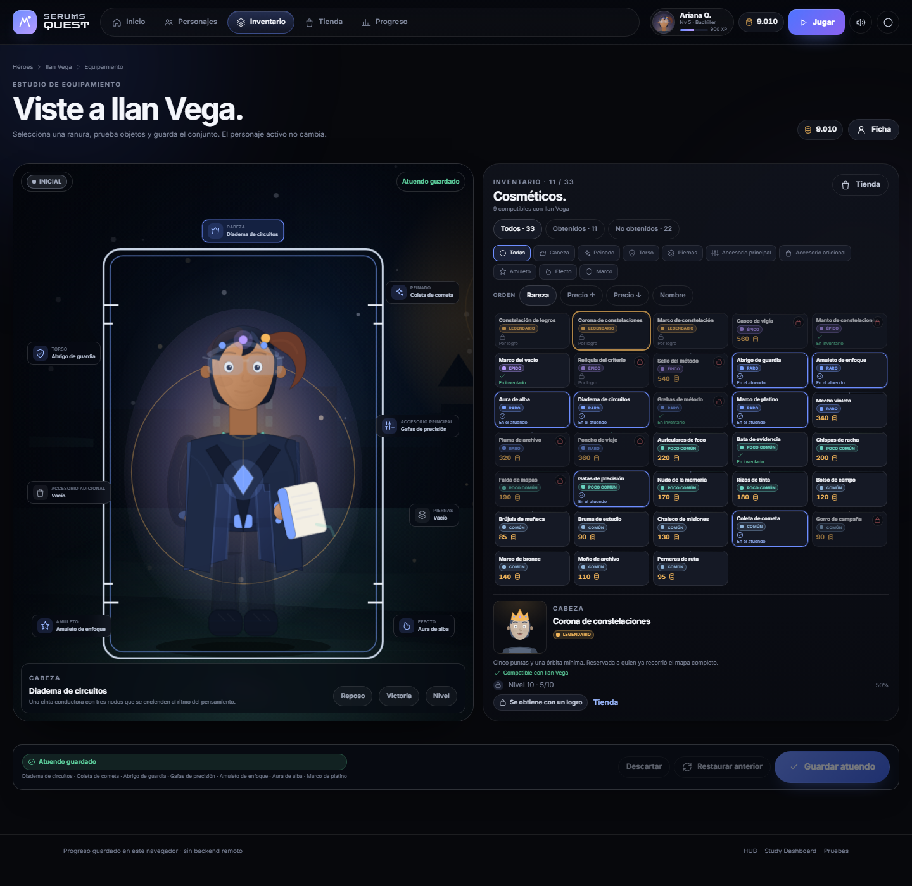
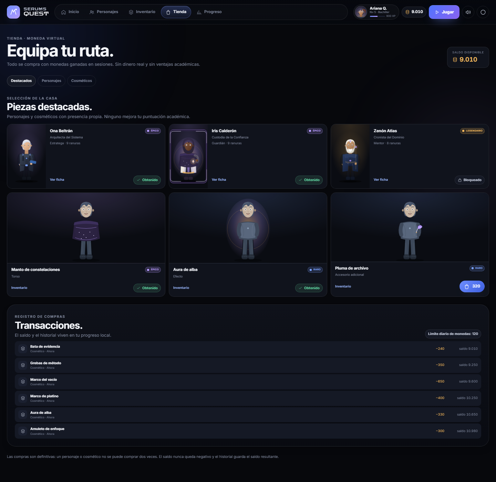
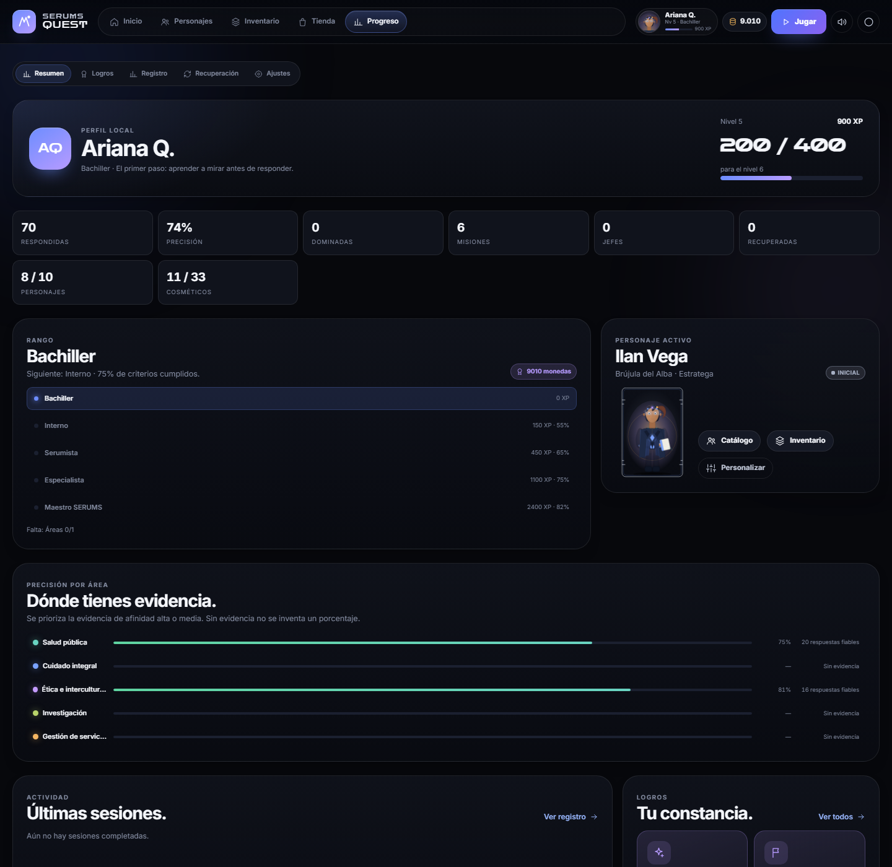
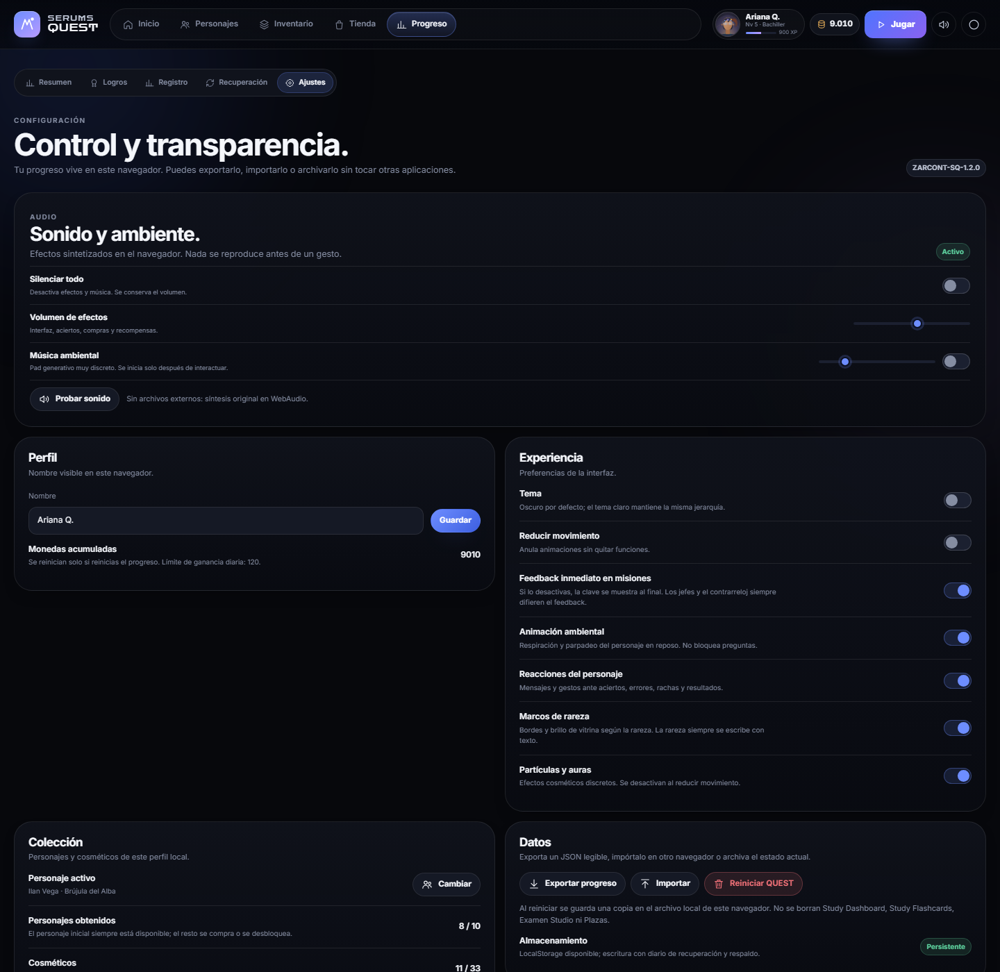
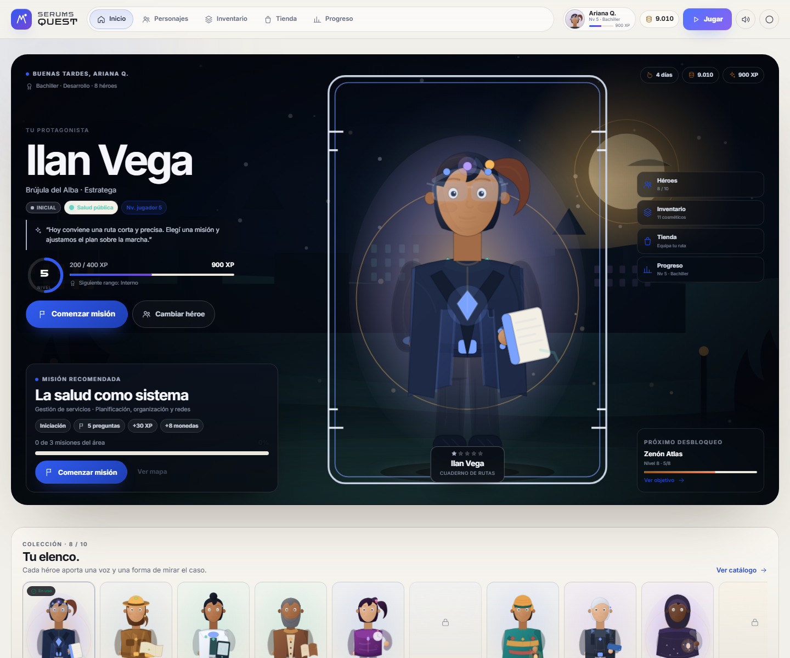
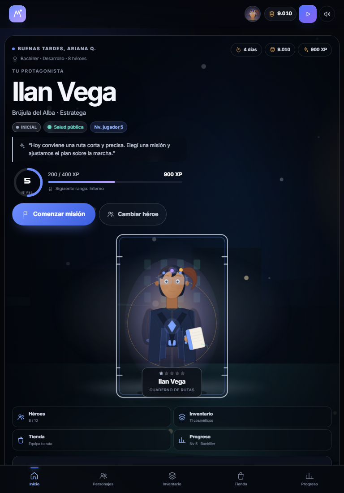
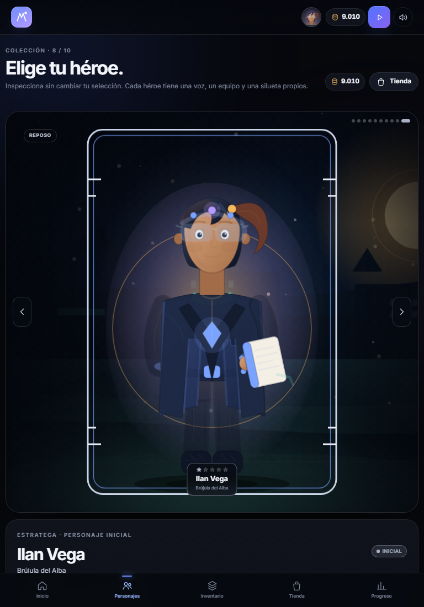

# SERUMS QUEST

RPG educativo estático integrado como quinta tarjeta del **SERUMS HUB**. Reutiliza por referencia el banco oficial de Psicología de **Examen Studio** y el temario de **Study Dashboard**, sin copiar ni modificar esos datos.

- **Build:** `ZARCONT-SQ-1.2.0`
- **Esquema de datos:** `2` (migración segura desde el esquema 1)
- **Mapa de contenido:** `1.0.2`
- **Catálogo RPG:** 10 personajes originales · 33 cosméticos · 9 categorías
- **Contenido fuente:** banco `1.0.0` (3 exámenes de Psicología, 300 preguntas) y temario Study `2.5.0`.



## Abrir

Desde el HUB:

1. Abre `index.html` en la raíz del repositorio.
2. Selecciona la quinta tarjeta **SERUMS QUEST** o pulsa `5`.
3. Pulsa **Abrir**.

También puedes abrir directamente `serums-quest/index.html`. La aplicación funciona sin compilación y sin backend.

Para servir el repositorio completo por HTTP (recomendado para pruebas y para que los PDFs y enlaces relativos se comporten igual que en el HUB):

```powershell
python -m http.server 8765 --bind 127.0.0.1
```

Abre `http://127.0.0.1:8765/index.html`.

## Experiencia de juego

- **Navegación en cinco secciones** (Inicio, Personajes, Inventario, Tienda y Progreso), con **Jugar** como acción destacada, barra inferior fija en móvil y subnavegación de Progreso (Resumen, Logros, Registro, Recuperación, Ajustes).
- **Game Home cinematográfico** con escenario SVG del área, protagonista a gran escala, frase de personalidad, nivel/rango/XP, misión recomendada, HUD de accesos, elenco, modos, semana y últimas sesiones.
- **Arena de héroes** con 10 personajes, escenario y vecinos, flechas/puntos/teclado, filtros por estado, rareza y orden, tira de elenco y detalle amplio. Inspeccionar no cambia el personaje activo.
- **Estudio de equipamiento** que unifica inventario y personalización: vista previa en vivo del borrador, nueve ranuras alrededor del personaje, filtros por categoría/propiedad/orden, compra contextual, guardar, descartar y restaurar el atuendo anterior.
- **Tienda** con destacados, personajes, cosméticos, precio, rareza, propiedad, confirmación de compra, faltante exacto e historial de transacciones.
- **Escenarios originales por área** (ciudad, sala de cuidado, salón ético, laboratorio y sala de gestión) con profundidad, niebla, partículas, parallax de puntero y pausa fuera de pantalla.
- **Audio original opcional**: 17 efectos sintetizados y pad ambiental de cinco voces; silencio global, volúmenes independientes, sin autoplay y sin archivos externos.
- **Reacciones conectadas a eventos reales**: acierto, racha de 3+, error, derrota, victoria, subida de nivel y desbloqueo. Mensajes propios por personalidad y animaciones SVG por partes.
- **Presentación cuidada**: degradados, contornos, luz de contorno, detalles de vestuario, caché de retratos, placa de rareza, presentación cinematográfica de desbloqueo y respeto a `prefers-reduced-motion`.

Las ilustraciones son SVG vectoriales originales creadas en código; las animaciones son cambios de estado y transformaciones por partes del SVG. No se usan emojis como sustituto de personajes. Los detalles, la auditoría de assets y los límites están en [docs/RPG-SYSTEM.md](docs/RPG-SYSTEM.md) y [docs/ASSETS.md](docs/ASSETS.md).

## Escenarios, arte y audio

- **Escenarios:** cinco SVG originales, uno por área de afinidad, con capas de cielo, arquitectura, suelo, niebla, partículas y viñeta. Se usan en Game Home, arena de héroes, estudio de equipamiento, resultado y desbloqueo. El parallax de puntero solo se activa en dispositivos de puntero fino y se desactiva con movimiento reducido.
- **Arte:** proporciones revisadas (cabeza/torso, cuello, hombros, piernas y botas), degradados de piel/tela/cabello, contornos, pliegues, puños y detalles de identidad. Caché de 180 retratos y 120 maniquíes; animaciones fuera de pantalla en pausa.
- **Audio:** 17 efectos y pad ambiental de cinco voces sintetizados en WebAudio, con compresor y reverb generada en código. Se desbloquea con el primer gesto; la música está apagada por defecto y el silencio/volúmenes se guardan en el estado.
- **Assets de terceros:** ninguno integrado. Se evaluaron cuatro repositorios visuales y varios packs CC0 de audio; la decisión y las licencias están documentadas en [docs/ASSETS.md](docs/ASSETS.md).

## Funcionalidades académicas conservadas

- Inicio con desafío recomendado, nivel, rango, racha, progreso por área y accesos a modos.
- Mapa de misiones con cinco rutas de área, nodos bloqueados/desbloqueados, jefes finales y requisitos visibles.
- Detalle de misión con reglas, recompensas, requisitos, trazabilidad y advertencia de contenido sin explicación editorial.
- Juego con feedback inmediato o diferido, teclado `A–D`/`1–4`, cronómetro, vidas, progreso y guardado tras cada respuesta.
- Resultados calculados solo con respuestas registradas: aciertos, errores, omisiones, precisión, cobertura, XP, monedas, logros, nivel, rango, etapa y fichas recomendadas.
- Recuperación de errores con repaso espaciado, historial y enlace real a la ficha de Study Dashboard.
- Perfil con XP, nivel, rango, precisión por área, dominio, racha, sesiones, logros y colección.
- Logros verificables con progreso real y recompensa única.
- Registro local de sesiones superadas; sin usuarios simulados ni clasificación mundial.
- Ajustes: nombre, tema, reducción de movimiento, feedback, preferencias de presentación, exportación/importación, reinicio con archivo de respaldo, verificación de contenido y diagnóstico.
- Migración de esquema, diario de escritura, respaldo y recuperación de estado dañado.

## Modos

| Modo | Regla principal | Recompensa de finalización |
| --- | --- | --- |
| Misiones | 5–6 preguntas, feedback inmediato, avance por área | 30 XP + 8 monedas, una vez por misión |
| Supervivencia | 10 preguntas, 3 oportunidades, 45 s por pregunta | 40 XP + 10 monedas, una vez al día |
| Contrarreloj | 3/5/8 min, 8/12/18 preguntas, precisión sobre total | 25 XP + 6 monedas si se supera |
| Recuperación | Errores programados, repaso espaciado | 30 XP + 5 monedas, una vez al día |
| Jefes finales | 8 preguntas, 90 s por pregunta, feedback diferido | 80 XP + 25 monedas, una vez por jefe |
| Desafío diario | 6 preguntas: repaso, exigencia y recuperación | 40 XP + 10 monedas, una vez al día |
| Simulacro | 20 preguntas, 15 min, etapa Dominio | 70 XP + 20 monedas, una vez al día |

Las misiones, el diario y la recuperación exigen un mínimo de precisión para considerarse superados: 60 %, 60 % y 50 % respectivamente. Las respuestas ya registradas conservan su XP de pregunta aunque la sesión no se supere.

## Economía RPG

Se reutiliza la moneda existente. No hay dinero real ni segunda moneda. Las reglas completas están en [docs/GAME-RULES.md](docs/GAME-RULES.md) y [docs/RPG-SYSTEM.md](docs/RPG-SYSTEM.md).

| Rareza | Precio de personaje | Precio de cosmético |
| --- | ---: | ---: |
| Común | 400–800 | 60–140 |
| Poco común | 900–1.500 | 150–260 |
| Raro | 1.600–2.400 | 280–420 |
| Épico | 2.800–4.000 | 480–680 |
| Legendario | 5.000–7.000 | 750–1.000 |

- Personaje inicial gratuito; el resto se compra o se desbloquea (Amaru por 5 misiones; Zenón exige nivel 8 y 5.400 monedas).
- Los precios están centralizados en `QUEST_CONFIG.rpg.prices`; el catálogo no los duplica.
- Cada compra comprueba existencia, propiedad, requisito y saldo; descuenta y concede en un único `commit`.
- No se puede comprar dos veces, no hay saldo negativo y todas las compras quedan en `economy.transactions`.
- Los personajes y cosméticos no otorgan ventajas académicas.

## Arquitectura

```
serums-quest/
  index.html                 Shell y carga de contenido compartido
  styles.css                 Sistema visual base (Premium Glass, responsive)
  styles-rpg.css             Capa RPG: rarezas, vitrina, carrusel, tienda, reacciones
  styles-game.css            HUD, navegación de cinco secciones, Game Home, arena, equipamiento, escenas y audio
  js/config.js               Reglas centralizadas: XP, monedas, niveles, etapas, logros, modos, precios RPG y preferencias
  js/util.js                 Fechas, hash determinista, escape, formato, descarga/lectura
  js/icons.js                Iconografía SVG local
  js/progression.js          Funciones puras de progresión, recompensas, etapas y logros
  js/characters.js           Catálogo de personajes y cosméticos (datos puros)
  js/character-art.js        Ilustraciones SVG originales, detalles, capas cosméticas y caché
  js/scenes.js               Cinco escenarios SVG originales por área
  js/audio.js                Efectos y pad ambiental sintetizados en WebAudio
  js/reactions.js            Mensajes por personalidad y evento
  js/collection.js           Colección, compras, equipamiento, filtros y validación
  js/store.js                Persistencia versionada, diario, respaldo, migraciones y bloqueo seguro
  js/content.js              Adaptador de BANCO_OFICIAL + STUDY_CONTENT + mapa de afinidad
  js/engine.js               Motor de sesiones, respuestas, recuperación y resultados
  js/app.js                  Router, pantallas, interacciones, audio y accesibilidad
  data/quest-map.js          Mapa derivado de IDs → área/tema/ficha/confianza (sin copiar preguntas)
  tools/build_content_map.py Generador reproducible del mapa
  tests/tests.html           Suite ejecutable en navegador (61 pruebas)
  tests/tests.js             Reglas, persistencia, contenido, motor, catálogo RPG, audio y economía
  tests/ui-check.html        Comprobación real de compra, equipamiento, recarga, teclado, audio y preferencias (44)
  tests/launcher-check.html  Apertura real desde el HUB por clic y por tecla 5 (7)
  tests/responsive.html      Viewports reales de 390/768/1280, barra inferior y arena
  tests/perf-check.html      Caché de arte, escenas y nodos SVG (9)
  tests/art-preview.html     Galería de los 10 personajes y las 33 capas
  tests/one.html             Revisión ampliada de personajes y estados concretos
  tests/visual-seed.html     Estado de demostración para capturas
  docs/                      Reglas, integración, sistema RPG, assets, QA y capturas
```

### Contrato de datos

`BANCO_OFICIAL` (global de Examen Studio) se consume sin modificarlo. Cada pregunta conserva:

- `id`, `examId`, `n`, `p` (página), `s` (enunciado), `o` (alternativas), `c` (clave), `st` (estado).
- URL al PDF original y página.
- `areaId`, `topicId`, `sheetId` y `confidence` desde `quest-map.js`.

`STUDY_CONTENT` (global de Study) se consume sin modificarlo. Las fichas se abren mediante
`../study-dashboard/index.html?sheet=<id>&from=quest`; abrir una ficha **no** marca dominio.

La capa RPG se define en `js/characters.js` y se guarda en el mismo documento de estado. El contrato completo está en [docs/RPG-SYSTEM.md](docs/RPG-SYSTEM.md).

### Persistencia

- Estado principal: `serumsquest:state:v1` (`schemaVersion 2`).
- Respaldo: `serumsquest:backup:v1`.
- Diario de escritura: `serumsquest:journal:v1`.
- Snapshot para el HUB: `serumsquest:snapshot:v1` (nivel, XP, rango, personaje activo y tamaño de colección).
- Archivos de recuperación/importación/reinicio: `serumsquest:archive:*`.
- Tema previo al arranque: `serumsquest:theme`.

No se leen ni escriben las claves de Study, Examen Studio o Plazas. El estado se escribe como un único documento con diario y respaldo. Si el documento está dañado y no hay respaldo, la app bloquea la escritura, archiva el contenido y muestra una pantalla de recuperación; nunca lo sobrescribe en silencio.

La migración 1 → 2 conserva XP, monedas, preguntas, errores, misiones, logros, sesiones y perfil, y crea la colección con Ilan como personaje inicial. No reinicia la economía ni regala monedas.

## Contenido

- 300 preguntas de Psicología con clave validada (3 exámenes).
- 232 preguntas puntuables con afinidad alta o media.
- 40 de afinidad baja y 28 sin área asignada: se conservan en el mapa, pero **no** entran en misiones ni modos puntuables.
- 13 misiones y 5 jefes.
- 10 correcciones editoriales explícitas en `MANUAL_OVERRIDES` del generador.
- El mapa no contiene enunciados, alternativas ni claves; solo IDs y metadatos derivados.

La afinidad es una capa editorial determinista, **no** una clasificación oficial del examen ni una nota académica. Los detalles están en `docs/CONTENT-INTEGRATION.md`.

## Pruebas

```powershell
python -m http.server 8765 --bind 127.0.0.1
```

- Reglas y economía: `http://127.0.0.1:8765/serums-quest/tests/tests.html` → **61/61**.
- Interfaz real: `http://127.0.0.1:8765/serums-quest/tests/ui-check.html` → **44/44**.
- Apertura desde el HUB: `http://127.0.0.1:8765/serums-quest/tests/launcher-check.html` → **7/7**.
- Responsive: `http://127.0.0.1:8765/serums-quest/tests/responsive.html` → **15/15**.
- Rendimiento gráfico: `http://127.0.0.1:8765/serums-quest/tests/perf-check.html` → **9/9**.
- Galería de arte: `http://127.0.0.1:8765/serums-quest/tests/art-preview.html`.
- Estado de demostración: `http://127.0.0.1:8765/serums-quest/tests/visual-seed.html?next=home`.

La suite expone `window.__QUEST_TESTS__`; la prueba de interfaz expone `window.__QUEST_UI__`, la del HUB `window.__QUEST_HUB__` y la de rendimiento `window.__QUEST_PERF__`. Cobertura: XP, niveles, rangos, etapas, anti-repetición, ledger, misiones al 0 %, recuperación, temporizador, persistencia, migración, estado dañado, esquema futuro, importación saneada, contenido, catálogo RPG, precios, compras, equipamiento por personaje, compatibilidad, filtros, reacciones, arte, escenas, audio, acciones de interfaz, teclado, preferencias, launcher, responsive y rendimiento.

Resultado de la última ejecución: **61 superadas · 0 fallidas**, **44 comprobaciones de interfaz · 0 fallidas**, **7/7 HUB**, **15/15 responsive** y **9/9 rendimiento**. Informe completo en [docs/QA-REPORT.md](docs/QA-REPORT.md).

## Capturas

| Game Home | Personajes |
| --- | --- |
|  |  |

| Estudio de equipamiento | Tienda | Progreso |
| --- | --- | --- |
|  |  |  |

| Ajustes y audio | Tema claro |
| --- | --- |
|  |  |

| Tablet · Inicio | Tablet · Personajes |
| --- | --- |
|  |  |

## Limitaciones conocidas

- La clasificación es local y de un solo perfil; no hay cuentas ni clasificación mundial.
- El registro competitivo solo incluye sesiones superadas con al menos 3 respuestas.
- El banco no contiene explicaciones editoriales por pregunta; la app muestra la clave y enlaza el PDF y una ficha de apoyo. No inventa explicaciones.
- La afinidad temática puede equivocarse en casos ambiguos; se marca como afinidad y las preguntas de baja confianza quedan fuera de la puntuación.
- Las ilustraciones son SVG vectoriales originales creadas en código, no arte final encargado. Cada personaje declara una ruta de sustitución (`assetReferences.upgradePath`).
- Las animaciones son transformaciones por partes del SVG y cambios de boca/expresión; no hay animación de esqueleto, video ni 3D.
- Los escenarios son fondos SVG generados, no mapas jugables ni tilemaps.
- El audio es síntesis original en WebAudio, no música grabada; puede variar según navegador y dispositivo. La música está apagada por defecto.
- La personalización guarda un atuendo por personaje y un único atuendo anterior restaurable.
- Las fuentes tipográficas se cargan desde Google Fonts (CDN). No hay backend ni telemetría.
- No se integró ningún asset visual o sonoro de terceros. La auditoría y las razones están en [docs/ASSETS.md](docs/ASSETS.md).
- La app está pensada para una pestaña activa. El almacén detecta cambios externos y bloquea escrituras sobre estados dañados, pero no implementa colaboración multiusuario.
- Abrir con `file://` puede tener límites de almacenamiento distintos según el navegador. Para probar la persistencia compartida con Study y Examen Studio, usa el servidor HTTP local.
- Los archivos de archivo/reinicio se conservan en localStorage; no hay una pantalla para restaurarlos automáticamente.

## Licencia

© 2026 ZARCONT. Licencia propietaria del repositorio. Los contenidos y PDFs de terceros conservan su procedencia y licencias originales.
