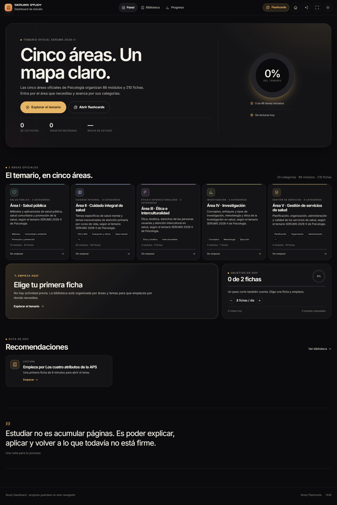
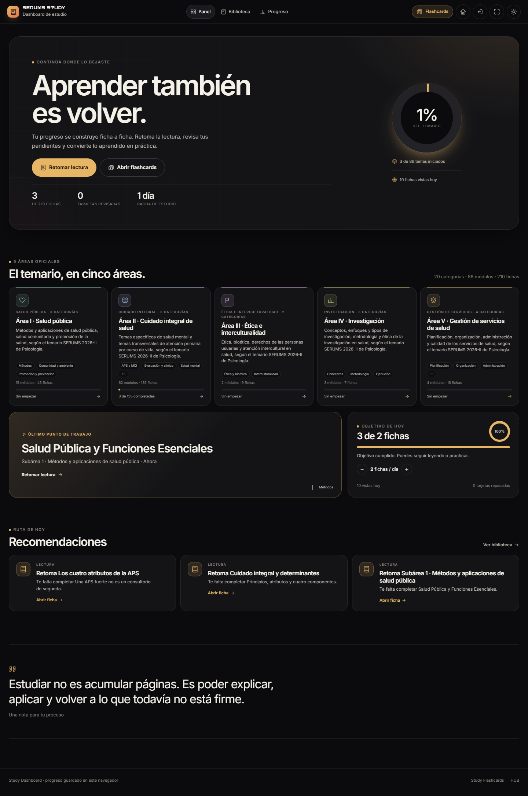
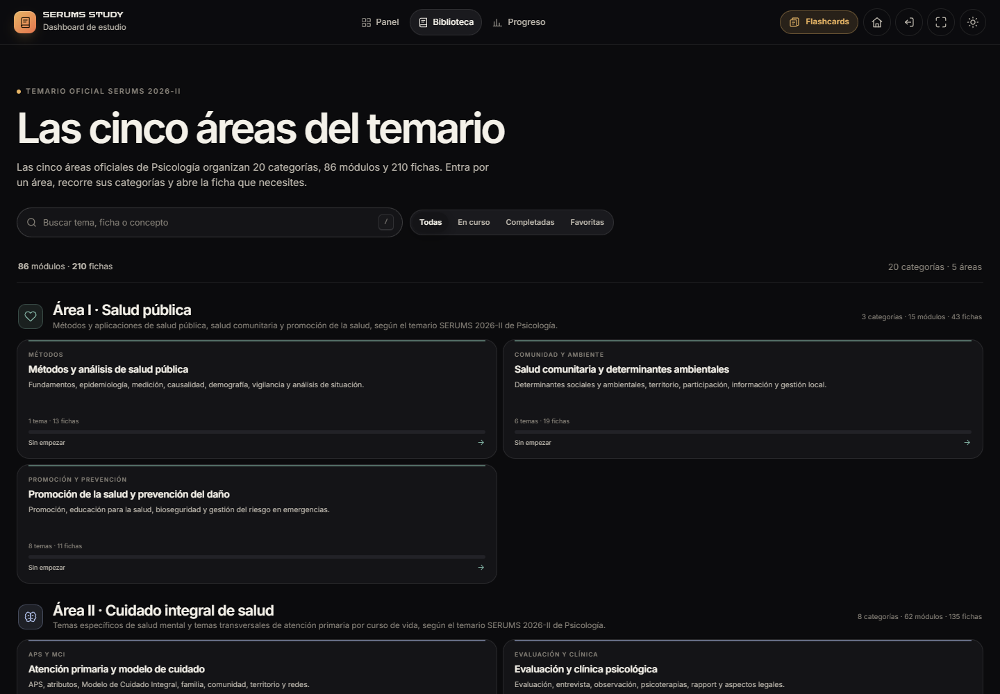
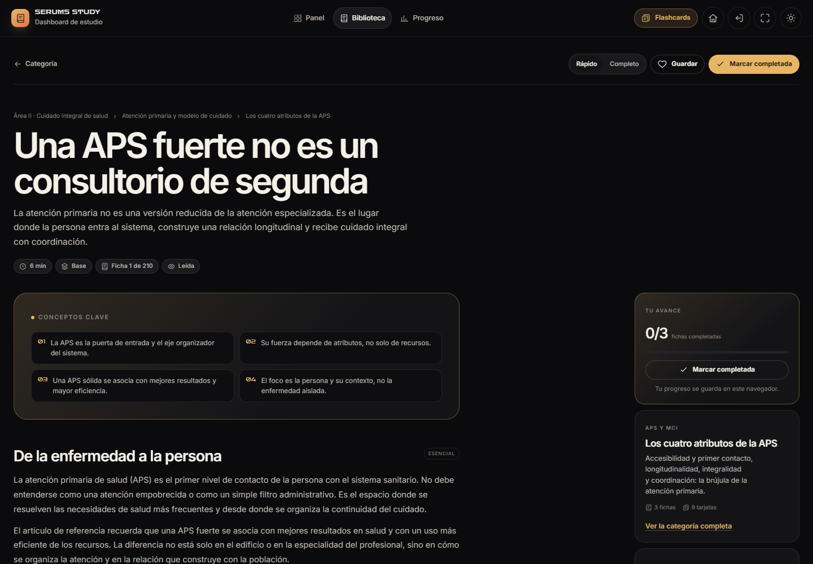
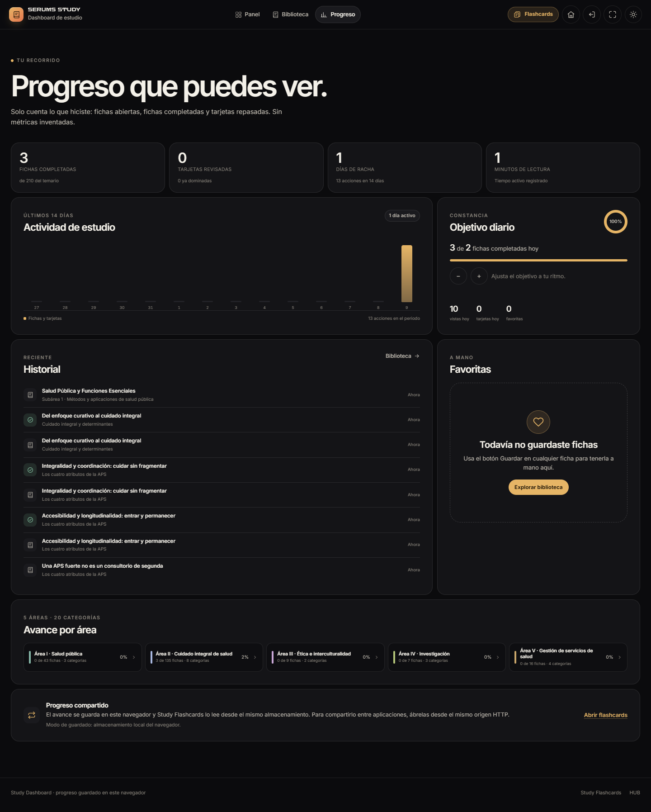
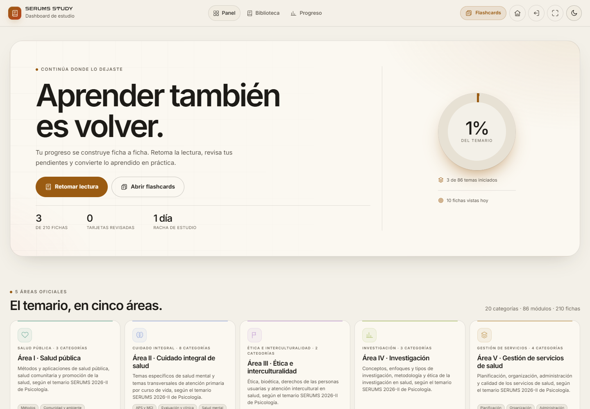
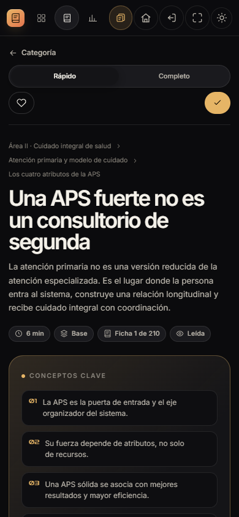

# Study Dashboard

## Informe técnico y de producto

**Aplicación:** Study Dashboard · SERUMS STUDY  
**Ruta:** `study-dashboard/` dentro del repositorio `ZARCONT SERUMS`  
**Fecha del informe:** 9 de noviembre de 2026  
**Ámbito:** código, contenido, interfaz, accesibilidad, rendimiento, persistencia e integración  
**Método:** lectura completa del código, análisis del temario con Node.js, auditoría real en Chrome headless (Playwright + axe-core), seis tamaños de pantalla y capturas de pantalla  
**Versión observada:** contenido `2.5.0`; assets de la app versionados como `2.2.1`/`2.2.2`; registro de autoría `2.2.0`  
**Estado:** aplicación estática funcional, sin backend ni proceso de compilación

> Este informe describe la copia local del proyecto. No se modificó el código de la aplicación; solo se añadieron los archivos de este informe y sus capturas en `informe/`.

---

## 1. Resumen ejecutivo

Study Dashboard es una aplicación web estática para **organizar, leer y medir el avance** del temario de Psicología del SERUMS 2026-II. No es una app de flashcards ni un banco de preguntas: es la capa de **lectura y progreso** del ecosistema SERUMS STUDY, y se conecta con Study Flashcards para convertir lo leído en recuperación activa.

La aplicación está construida con JavaScript clásico, sin framework, sin build y sin servidor. Todo el contenido vive en un único archivo de datos de 2,59 MB (`study-data/temario.js`), y el progreso se guarda en el navegador con IndexedDB y localStorage. Esa decisión la hace muy fácil de ejecutar y de auditar, pero también concentra en el navegador todos los riesgos de pérdida de datos.

**Lo mejor:**

- Contenido amplio y bien estructurado: 5 áreas, 20 categorías, 86 módulos, 210 fichas y 630 tarjetas.
- Progreso honesto: fichas vistas, completadas, favoritas, tiempo de lectura, racha y actividad de 14 días; sin métricas inventadas.
- Lector cuidado: modo rápido/completo, conceptos clave, tablas, avisos, fuentes enlazadas al PDF y restauración de la posición de lectura.
- Navegación profunda y tolerante: rutas por hash, enlaces directos a fichas, limpieza de parámetros antiguos y estados 404 con alternativas.
- Integración real con el HUB y con Study Flashcards mediante un almacén compartido y un snapshot de progreso.
- Identidad visual coherente: ámbar sobre negro, tema claro de papel, tipografía Inter/Zen Dots y detalles editoriales.
- Accesibilidad de base por encima de la media: `lang`, enlace de salto, un `h1` por vista, `aria-current`, `aria-pressed`, `aria-live`, foco gestionado, `prefers-reduced-motion` y atajo `/`.

**Lo que hay que corregir antes de distribuirlo a estudiantes:**

1. **Tema claro con contraste insuficiente** en estados de éxito y aviso: la etiqueta «Completada» mide 1,45:1 y el icono de advertencia 2,16:1. Son colores semánticos pensados para fondo oscuro que no se adaptaron al tema claro.
2. **Botones del lector sin nombre accesible en móvil:** al ocultar el texto con `display:none`, «Guardar» y «Marcar completada» quedan como iconos sin `aria-label`. axe lo marca como crítico.
3. **Sin exportación ni copia de seguridad del progreso:** borrar los datos del navegador elimina todo el avance. Para una app de estudio de 42 horas de contenido, es el mayor riesgo de producto.
4. **Peso inicial alto:** 2,47 MiB de JavaScript de contenido (568 KB comprimido) que se descargan y parsean en cada carga fría. En un móvil de gama baja puede notarse.
5. **Pérdida de la posición al volver a la biblioteca:** el lector restaura su scroll, pero la biblioteca vuelve siempre arriba.
6. **Detalles de pulido:** objetivo que muestra «3 de 2», 22 fichas cuyo botón «Completo» no cambia nada, una sola recomendación en una rejilla de tres columnas, cabecera duplicada en la página de área y duplicados en el historial.

**Veredicto:** producto sólido y muy bien pensado para uso personal; con las correcciones de accesibilidad y una exportación de progreso quedaría listo para un uso real continuado. No es una plataforma multiusuario ni una app con sincronización entre dispositivos, y no pretende serlo.

### Valoración orientativa

| Dimensión | Valoración | Motivo |
|---|---|---|
| Propósito y enfoque | Excelente | Resuelve una necesidad concreta y no intenta ser todo a la vez. |
| Contenido y cobertura | Excelente | 210 fichas, 630 tarjetas y 48 fuentes; estructura verificable. |
| Experiencia de lectura | Muy buena | Lector claro, modos, fuentes y restauración de posición. |
| Navegación | Buena | Rutas profundas y búsqueda; pierde scroll al volver a la biblioteca. |
| Diseño visual | Excelente en oscuro / buena en claro | Identidad fuerte; contraste mejorable en tema claro. |
| Accesibilidad | Buena con fallos corregibles | Base sólida; 3 tipos de fallo en lector móvil y contraste claro. |
| Rendimiento | Mejorable | 2,47 MiB de contenido en cada carga fría. |
| Persistencia | Buena, pero sin red de seguridad | IndexedDB + localStorage + merge; falta exportar/importar. |
| Integración | Excelente | HUB y Flashcards comparten estado y enlaces profundos. |
| Documentación y versionado | Mejorable | Registro 2.2.0 frente a assets 2.2.1/2.2.2; falta `meta author`. |

---

## 2. Ficha técnica

| Campo | Valor |
|---|---|
| Nombre | Study Dashboard |
| Marca | SERUMS STUDY · ZARCONT |
| Tipo | Aplicación web estática de una sola página (SPA por hash) |
| Propósito | Organizar el temario, leer fichas resumidas y seguir el progreso real |
| Público | Postulantes de Psicología al SERUMS 2026-II; estudio individual |
| Idioma | Español (Perú); fechas con `es-PE` |
| Stack | HTML5, CSS3 y JavaScript ES5/ES2017, sin framework ni dependencias npm |
| Build | No requiere compilación |
| Backend | Ninguno |
| Persistencia | IndexedDB `study-serums` + localStorage `study-state-v1` |
| Datos | `study-data/temario.js` (2.587.623 bytes) |
| Autoría | ZARCONT; licencia propietaria © 2026 |
| Versión de contenido | 2.5.0 |
| Versión de assets | `app.js?v=2.2.1`, `styles.css?v=2.2.2` |
| Versión registrada | `AUTORIA.md`: Study Dashboard 2.2.0 |
| Tema | Oscuro por defecto; claro persistente |
| Responsive | Sí; breakpoints 1150, 940, 760, 620 y 380 px |
| Accesibilidad | Base WCAG orientada a AA; incumplimientos puntuales medidos |
| Navegadores objetivo | Chrome, Edge, Firefox y Safari modernos; probado en Chrome |
| Arranque | Servir la carpeta raíz `ZARCONT SERUMS` por HTTP |

### Archivos principales

| Archivo | Tamaño | Líneas | Responsabilidad |
|---|---:|---:|---|
| [`index.html`](../index.html) | 4.618 B | 105 | Estructura, appbar, montaje de iconos y scripts |
| [`app.js`](../app.js) | 67.742 B | 1.330 | Router, vistas, eventos, lector y progreso |
| [`styles.css`](../styles.css) | 38.510 B | 504 | Panel, biblioteca, lector, progreso y responsive |
| [`study-data/temario.js`](../../study-data/temario.js) | 2.587.623 B | — | Fuentes, áreas, temas, fichas, tarjetas y metadatos |
| [`study-shared/store.js`](../../study-shared/store.js) | 34.865 B | 959 | Estado, persistencia, estadísticas y recomendaciones |
| [`study-shared/taxonomy.js`](../../study-shared/taxonomy.js) | 17.359 B | 437 | 5 áreas primarias, 20 categorías y mapas derivados |
| [`study-shared/base.css`](../../study-shared/base.css) | 16.882 B | 361 | Tokens, componentes y responsive compartido |
| [`study-shared/ui.js`](../../study-shared/ui.js) | 6.920 B | — | Utilidades de interfaz, formato, toasts y tema |
| [`study-shared/icons.js`](../../study-shared/icons.js) | 5.369 B | — | Iconos SVG en línea |
| [`serums-chrome.js`](../../serums-chrome.js) | 12.494 B | — | Controles Inicio, HUB y pantalla completa |
| [`serums-chrome.css`](../../serums-chrome.css) | 3.209 B | — | Estilos de esos controles |
| [`serums-mobile.css`](../../serums-mobile.css) | 10.943 B | — | Safe areas y ajustes móviles del ecosistema |

Además, la aplicación referencia 48 PDFs en `study-data/fuentes/` que suman **218.480.775 bytes (≈208 MiB)**. No se cargan al abrir la app; solo cuando el usuario abre una fuente.

---

## 3. Qué es y qué no es

Study Dashboard es una de las cinco aplicaciones del lanzador SERUMS HUB. La separación es deliberada: cada app resuelve una parte del ciclo de estudio.

| Aplicación | Función | Relación con Study Dashboard |
|---|---|---|
| SERUMS HUB | Lanzador y tarjeta de progreso | Lee `studyhub:snapshot:v1` y muestra avance y último punto |
| BANQUEO · Examen Studio | Banco de preguntas y práctica de examen | Independiente; no comparte el temario de Study |
| PLAZAS SERUMS | Explorador de plazas y adjudicación | Independiente |
| **Study Dashboard** | **Temario, fichas, lector y progreso de lectura** | **App de este informe** |
| Study Flashcards | Recuperación activa con 630 tarjetas | Comparte `StudyStore`, progreso y enlaces profundos |
| SERUMS QUEST | Capa RPG educativa | Reutiliza banco y temario por referencia |

**Es:**

- Un mapa navegable del temario oficial de Psicología 2026-II.
- Un lector de fichas resumidas con nivel, duración, conceptos clave, tablas, avisos y fuentes.
- Un registro local de avance: vistas, completadas, favoritas, tiempo, racha y actividad.
- Un puente hacia Study Flashcards para practicar la ficha que se está leyendo.

**No es:**

- Un banco de preguntas de examen.
- Un entrenador de flashcards (esa es la otra app).
- Una plataforma con cuentas, nube o sincronización entre dispositivos.
- Un gestor documental: no permite editar fichas ni subir contenido desde la interfaz.
- Un sistema de recomendaciones basado en IA: las recomendaciones son reglas locales y deterministas.

---

## 4. La experiencia de uso

### 4.1 Panel

El panel es la portada y el centro de decisión diaria. Se compone de:

- **Hero editorial** con dos estados: primera visita («Cinco áreas. Un mapa claro.») y usuario con actividad («Aprender también es volver.»).
- **Anillo de progreso** del temario completo y dos notas de contexto: temas iniciados y fichas vistas hoy.
- **Tres cifras**: fichas completadas, tarjetas revisadas y racha.
- **Cinco tarjetas de área** con color, icono, descripción, categorías, módulos, fichas y barra de progreso.
- **Tarjeta de reanudación** con la última ficha, su contexto y tiempo relativo.
- **Objetivo diario** ajustable entre 1 y 20 fichas, con anillo, barra y contadores del día.
- **Hasta tres recomendaciones** generadas por reglas: repaso pendiente, tema empezado sin completar, tema sin empezar y refuerzo de errores.
- **Cita de cierre** sobre estudiar para explicar y aplicar, no para acumular páginas.



*Primera visita: el hero explica el temario y ofrece una acción principal; las cinco áreas aparecen debajo.*

En la primera visita solo hay una recomendación, así que la rejilla de tres columnas deja dos espacios vacíos. Es el primer detalle visual a pulir.

Con actividad, el panel cambia de narrativa y prioriza «Retomar lectura», el último punto de trabajo y las recomendaciones pendientes.



*Estado con tres fichas completadas: el hero cambia a «Aprender también es volver» y el acceso principal pasa a «Retomar lectura».*

### 4.2 Biblioteca

La biblioteca es la vista más profunda. Tiene tres niveles:

1. **Las cinco áreas** con sus categorías.
2. **La categoría** con sus módulos o fichas oficiales.
3. **La ficha** dentro de un módulo plegable.

Herramientas:

- **Búsqueda** por título, resumen, conceptos clave, palabras clave del tema, área y categoría. Atajo `/` para enfocar el campo.
- **Filtros** «Todas», «En curso», «Completadas» y «Favoritas».
- **Resumen dinámico** de módulos, fichas, categorías y áreas encontradas.
- **Módulos plegables** con estado textual («Sin empezar», «En curso», «Completada») y contador `completadas/total`.
- **Fichas oficiales** que pertenecen a la categoría pero no a un tema concreto, mostradas como grupo aparte.
- **Estado vacío** con acción para limpiar filtros o volver al panel.



*La biblioteca agrupa por área y muestra categorías con descripción, número de temas, fichas y progreso. La búsqueda y los filtros quedan siempre a mano.*

La búsqueda no recorre el cuerpo de las fichas: solo título, resumen, conceptos clave, `kicker`, área y categoría. Para 195.847 palabras de contenido, esa es una limitación importante si el usuario recuerda una frase que solo aparece en un párrafo.

### 4.3 Lector de ficha

El lector es la pieza más trabajada. Cada ficha muestra:

- **Migas de pan** área → categoría → tema, con chip «Desde flashcards» cuando se entra desde la otra app.
- **Título y resumen** con tipografía editorial.
- **Metadatos**: minutos, nivel, posición global («Ficha 1 de 210») y estado («Nueva», «Leída» o «Completada»).
- **Conceptos clave** numerados en una rejilla de dos columnas.
- **Secciones** con párrafos, listas, tablas y avisos. Cada sección se etiqueta como «Esencial» o «Ampliación».
- **Modo rápido** (solo secciones `core`) y **modo completo** (todas). La preferencia se guarda en `study-dashboard-mode`.
- **Práctica con flashcards**: total de tarjetas, pendientes, dominadas y errores de la ficha, con botón a Study Flashcards.
- **Fuentes**: cada referencia abre el PDF original en la página indicada, con `target="_blank"` y `rel="noopener"`.
- **Paginador** anterior/siguiente.
- **Rail lateral**: progreso del tema, botón de completar, resumen del tema y tipo de contenido.
- **Acciones**: favorito, completar, cambiar modo. Los cambios se confirman con un toast y se reflejan al instante en el rail.
- **Restauración de lectura**: guarda la posición como ratio, la restaura tras recargar o volver a la ficha y cancela la restauración si el usuario hace scroll.



*Lector: conceptos clave, secciones y rail de progreso. El botón «Completo» revela las secciones de ampliación.*

La lectura se registra en bloques: `flushReading` cada 30 segundos, al cambiar de ruta, al ocultar la pestaña y al cerrar. Solo cuenta bloques de al menos 3 segundos.

### 4.4 Progreso

La vista de progreso resume lo que el usuario hizo, sin métricas decorativas:

- Cuatro indicadores: fichas completadas, tarjetas revisadas, días de racha y minutos de lectura.
- Gráfico de actividad de los últimos 14 días, con barras por día y resumen de acciones.
- Objetivo diario con anillo, barra, control de menos/más y contadores del día.
- Historial reciente de fichas abiertas, completadas y sesiones de flashcards.
- Favoritas, con estado vacío y acción para explorar la biblioteca.
- Avance por cada una de las cinco áreas.
- Nota de almacenamiento compartido con Flashcards y modo de guardado.



*Progreso real de la sesión de auditoría: 3 fichas completadas, 1 minuto de lectura, 13 acciones en 14 días. El objetivo se superó y la interfaz lo muestra como «3 de 2», un detalle de copy a corregir.*

### 4.5 Navegación cruzada

El flujo de ida y vuelta está bien resuelto:

1. Desde una ficha, «Practicar con flashcards» abre `study-flashcards/index.html?deck=<sheet>&mode=free&sheet=<sheet>&from=dashboard`.
2. Study Flashcards guarda el origen en `sessionStorage` y ofrece «Consultar ficha resumen».
3. Al volver al dashboard con `?sheet=<id>&from=flashcards&deck=<id>`, la app limpia la query, la convierte en `#/ficha/<id>`, muestra el chip «Desde flashcards» y cambia el botón de volver a «Volver a flashcards».
4. El HUB lee el snapshot y muestra el progreso y el último punto, sin cargar el temario completo.

Ese contrato está bien pensado y se verificó en ejecución: la query se limpia, el hash queda canónico y el botón de vuelta apunta al mazo correcto.

---

## 5. El contenido

### 5.1 Estructura

El temario se organiza en cinco áreas oficiales de Psicología, veinte categorías y ochenta y seis módulos. La jerarquía real es:

```
fuente (48)
  └── tema / módulo (86: 85 temas + 1 contenedor)
        └── ficha (210)
              ├── sección (1.392)
              ├── concepto clave (1.231)
              └── tarjeta (630: 210 concepto + 210 múltiple + 210 aplicación)
```

Cada ficha pertenece a un tema; cada tema, a una categoría; cada categoría, a una de las cinco áreas primarias. Las 18 áreas heredadas del contenido original se usan como alias y se remapean a las cinco áreas oficiales; la interfaz solo muestra cinco.

### 5.2 Cobertura por área

| Área | Categorías | Módulos (UI) | Fichas | % del total |
|---|---:|---:|---:|---:|
| I · Salud pública | 3 | 15 | 43 | 20,5 % |
| II · Cuidado integral de salud | 8 | 62 | 135 | 64,3 % |
| III · Ética e interculturalidad | 2 | 2 | 9 | 4,3 % |
| IV · Investigación | 3 | 3 | 7 | 3,3 % |
| V · Gestión de servicios de salud | 4 | 4 | 16 | 7,6 % |
| **Total** | **20** | **86** | **210** | **100 %** |

> **Matiz de conteo:** los 86 «módulos» de la interfaz incluyen un tema contenedor (`topic-psi-ci-2`) con 22 fichas oficiales. Si se cuentan solo temas con contenido propio, son **85 temas**; el contenedor aporta las 22 fichas que la biblioteca muestra como «Fichas oficiales del temario». El Área II muestra 62 módulos porque suma sus 61 temas + el contenedor.

La distribución es desigual: el Área II concentra casi dos tercios de las fichas. Es coherente con el peso de cuidado integral, salud mental y curso de vida en el temario, pero conviene tenerlo presente al planificar: no es un temario de cinco bloques equivalentes.

### 5.3 Categorías

| Área | Categoría | Temas | Fichas |
|---|---|---:|---:|
| I | Métodos y análisis de salud pública | 1 | 13 |
| I | Salud comunitaria y determinantes ambientales | 6 | 19 |
| I | Promoción de la salud y prevención del daño | 8 | 11 |
| II | Atención primaria y modelo de cuidado | 7 | 14 |
| II | Evaluación y clínica psicológica | 1 | 8 |
| II | Salud mental, consumo y violencias | 16 | 32 |
| II | Gestación, infancia y adolescencia | 13 | 26 |
| II | Adultez, vejez, crónicas y nutrición | 12 | 26 |
| II | Prevención y detección temprana | 0 | 4 |
| II | ITS, VIH, hepatitis y transmisión vertical | 8 | 16 |
| II | Seguridad del paciente e IAAS | 4 | 9 |
| III | Ética y bioética | 1 | 3 |
| III | Atención intercultural en salud | 1 | 6 |
| IV | Conceptos y clasificación | 1 | 3 |
| IV | Metodología | 1 | 2 |
| IV | Ejecución y comunicación | 1 | 2 |
| V | Planificación y presupuesto | 1 | 3 |
| V | Organización de los servicios | 1 | 7 |
| V | Administración de los servicios | 1 | 4 |
| V | Sistema de gestión de la calidad | 1 | 2 |

«Prevención y detección temprana» no tiene temas propios: sus 4 fichas son oficiales y se muestran como grupo aparte. Es una consecuencia del diseño del temario, no un error de datos; la interfaz lo resuelve bien.

### 5.4 Volumen y esfuerzo

| Métrica | Valor |
|---|---:|
| Fuentes declaradas | 48 |
| Referencias de fuente en fichas | 254 |
| Temas / módulos | 86 (85 + 1 contenedor) |
| Fichas | 210 |
| Tarjetas | 630 |
| Secciones | 1.392 |
| Secciones esenciales (`core`) | 879 |
| Secciones de ampliación (`full`) | 513 |
| Conceptos clave | 1.231 |
| Palabras (título, resumen, conceptos, secciones, tablas y avisos) | 195.847 |
| Minutos declarados de lectura | 2.524 (≈ 42 h 4 min) |
| Media por ficha | 933 palabras · 12 min · 6,6 secciones · 5,9 conceptos |
| Ficha más corta / más larga | 223 / 4.492 palabras; 5 / 22 min |
| Niveles | 80 Base · 92 Intermedio · 38 Avanzado |
| Fichas con tablas | 189 (90 %) |
| Fichas con avisos | 210 (100 %) |
| Fichas con aviso de advertencia (`warn`) | 72 (34 %) |
| Fichas solo con secciones esenciales | 22 (10,5 %) |

A 30 minutos diarios, el temario completo son unas **12 semanas** de lectura; a 60 minutos, unas **6 semanas**. Son cifras útiles para planificar, pero no incluyen el tiempo de repaso con flashcards.

### 5.5 Fuentes

Las 48 fuentes son, en su mayoría, documentos técnicos y normativos del MINSA, guías de práctica clínica, normas técnicas, leyes y un artículo académico. También hay cinco documentos de síntesis del temario de Psicología.

| Tipo | Cantidad |
|---|---:|
| Normas técnicas | 14 |
| Guías de práctica clínica y guías técnicas | 13 |
| Documentos técnicos | 6 |
| Material de estudio / síntesis | 5 |
| Manuales | 2 |
| Leyes y reglamentos | 3 |
| Artículo, declaración, política, directiva y temario | 5 |
| **Total** | **48** |

Dos fuentes no están referenciadas por ninguna ficha:

- `src-psico-temario`: el PDF del temario oficial de Psicología 2026-II. Se usa para estructurar el contenido, pero ninguna ficha lo cita.
- `src-nutricion-ninos-anterior`: una versión anterior de la guía de nutrición infantil.

Las cinco síntesis de Psicología sí se citan: salud pública (31 fichas), cuidado integral (30), gestión (16), ética (9) e investigación (7).

### 5.6 Integridad de los datos

La comprobación programática no encontró errores estructurales:

- **0 IDs duplicados** entre fuentes, temas, fichas y tarjetas.
- **0 fichas sin tema** y **0 temas sin fichas**.
- **0 fichas sin tarjetas**; las 210 tienen exactamente 3.
- **0 fichas sin categoría** y **0 incidencias de taxonomía**.
- **210 de 210 fichas** asignadas a un área primaria.
- **48 PDFs existentes** y accesibles; ninguno roto.
- **46 de 48 fuentes** referenciadas directamente.

La calidad estructural es alta. La calidad *editorial* es más desigual: hay fichas de 2 secciones y 223 palabras junto a fichas de 19 secciones y 4.492 palabras. No es un defecto grave —el temario tiene temas de distinta densidad—, pero el usuario percibe saltos de esfuerzo entre fichas.

---

## 6. Arquitectura

### 6.1 Vista general

```
study-data/temario.js
   └── window.STUDY_CONTENT
          │
          ├── study-shared/taxonomy.js  → áreas, categorías, mapas, alias
          ├── study-shared/store.js     → estado, estadísticas, persistencia
          ├── study-shared/ui.js        → escapeHTML, iconos, toasts, tema
          ├── study-shared/icons.js     → SVG inline
          └── study-dashboard/app.js    → router + vistas + eventos
                    │
                    ├── localStorage  study-state-v1
                    ├── IndexedDB     study-serums / state / main
                    └── localStorage  studyhub:snapshot:v1  → HUB
```

Study Flashcards lee y escribe el mismo `StudyStore`; el HUB solo lee el snapshot. `serums-chrome.js` monta los controles de Inicio, HUB y pantalla completa en la appbar existente.

### 6.2 Modelo de ejecución

- **Scripts clásicos**, sin módulos ES ni bundler. El orden de carga importa: contenido → taxonomía → iconos → UI → store → chrome → app.
- **Sin framework**: las vistas son funciones que devuelven cadenas HTML; se asignan con `innerHTML`.
- **Delegación de eventos** global en `document` para clics, `input` y teclado; un listener de `hashchange` para rutas.
- **Estado de interfaz** en un objeto `state` de `app.js`; estado persistente en `StudyStore`.
- **Render completo por ruta**: no hay DOM virtual ni reconciliación. Es simple y suficiente para 210 fichas.
- **Carga única del contenido**: 2,59 MB de JS se evalúan al inicio; no hay carga diferida por área.

### 6.3 Rutas

| Ruta | Vista | Notas |
|---|---|---|
| `#/` | Panel | Portada; estado inicial o con actividad |
| `#/biblioteca` | Biblioteca completa | Cinco áreas y veinte categorías |
| `#/biblioteca/:area` | Área | Categorías y progreso del área |
| `#/biblioteca/:area/:categoria` | Categoría | Módulos plegables y fichas oficiales |
| `#/ficha/:sheetId` | Lector | Ficha concreta; restaura posición |
| `#/progreso` | Progreso | KPIs, actividad, historial, favoritas |
| Otra ruta | 404 | Estado vacío con alternativas |

Parámetros de entrada:

- `?sheet=<id>`: abre una ficha concreta y limpia la query.
- `?from=flashcards`: marca el origen y cambia el botón de vuelta.
- `?deck=<id>`: mazo de Flashcards al que volver.

La app canonicaliza áreas heredadas y categorías mal combinadas con `history.replaceState`; si el enlace mezcla un área y una categoría que no le corresponden, muestra un 404 explicativo.

### 6.4 Persistencia

| Clave | Almacén | Función |
|---|---|---|
| `study-state-v1` | localStorage | Estado completo, respaldo y merge entre pestañas |
| `study-serums` / `state` / `main` | IndexedDB | Estado primario |
| `studyhub:snapshot:v1` | localStorage | Snapshot ligero para el HUB |
| `study-theme` | localStorage | Tema oscuro/claro |
| `study-dashboard-mode` | localStorage | Modo rápido/completo |

El estado guarda:

- `sheets`: por ficha, vistas, primera vista, última apertura, completada, favorita, scroll y segundos de lectura.
- `cards`: por tarjeta, caja, vencimiento, último repaso, resultado, aciertos, fallos y lapsos.
- `sessions`: hasta 100 sesiones de Flashcards.
- `activity`: por día, vistas, completadas, repasos, aciertos, fallos y segundos.
- `goals.dailySheets`, `history` (máximo 60), `last.dashboard`, `last.flashcards` y `flashSession`.

El guardado es defensivo:

- `pickNewer` elige el estado con `updatedAt` más reciente entre IndexedDB y localStorage.
- `mergeStates` combina fichas, tarjetas, sesiones, actividad, historial, objetivos y último punto.
- Los contadores de actividad usan `Math.max` para no duplicar entre pestañas.
- `storage` sincroniza entre pestañas; `visibilitychange` y `pageshow` recuperan estados de bfcache.
- Si IndexedDB no está disponible, cae a localStorage y lo informa en Progreso.

**Lo que falta:** exportar/importar el estado, borrar el progreso desde la interfaz y una política de poda de datos obsoletos. El estado no se sincroniza entre dispositivos.

### 6.5 Errores y degradación

| Situación | Comportamiento |
|---|---|
| Falta el contenido | Estado de error con reintento e ir al HUB |
| Faltan módulos compartidos | Estado de error (con una dependencia frágil: el propio error usa `StudyUI`) |
| Falla IndexedDB | Respaldo en localStorage; la app sigue leyendo |
| Falla el almacenamiento por completo | Aviso, pero el render posterior puede reemplazarlo (ver hallazgos) |
| Temario vacío | Estado vacío con enlaces a Flashcards y HUB |
| Ficha inexistente | 404 con tres fichas alternativas |
| Área/categoría inválida | 404 explicativo |
| Enlace antiguo `?sheet` | Redirección al panel con aviso |
| Falta `StudyTaxonomy` | Degradación silenciosa a 23 áreas heredadas, sin categorías (no se comprueba) |

### 6.6 Seguridad y privacidad

- **Todo es local**: no hay backend, cuentas, cookies de sesión ni analítica.
- **Única petición externa**: Google Fonts (Inter y Zen Dots). El resto es local.
- **Escape sistemático** con `UI.escapeHTML` en títulos, resúmenes, secciones, tablas, avisos, fuentes y búsqueda.
- **PDFs** con `target="_blank"` y `rel="noopener"`.
- **Sin `eval`** en el código de la app; el archivo de datos es un script local de confianza.
- **Riesgo principal**: pérdida de progreso al limpiar datos del navegador o cambiar de dispositivo.
- **Dependencia de mismo origen**: para compartir estado con Flashcards, ambas apps deben servirse desde el mismo origen HTTP. Abrir `index.html` con `file://` puede aislar el almacenamiento.
- **CSP**: no hay; sería una mejora de defensa en profundidad, con permiso para Google Fonts.

---

## 7. Diseño y responsive

### 7.1 Identidad visual

- **Tema oscuro por defecto**: fondo `#0B0B0D`, superficie `#141417`, texto `#F4F1E9`.
- **Acento ámbar**: `#E6B566` en oscuro y `#9A5B12` en claro.
- **Tema claro de papel**: fondo `#F3F0E8`, superficie `#FBF8F1`, texto `#1D1B17`.
- **Rojo de marca**: `#DF2531`; verde de éxito `#8FD3B0`; rojo de peligro `#F07A7A`.
- **Tipografía**: Inter 400–800 para interfaz y lectura; Zen Dots para la marca.
- **Detalles editoriales**: rejilla sutil en el hero, anillos cónicos de progreso, bordes finos, mayúsculas espaciadas y tarjetas de papel.



*Tema claro: la identidad se mantiene, pero los colores semánticos de éxito y aviso no se adaptaron (ver Accesibilidad).*

### 7.2 Composición

- Ancho máximo de página: 1400 px.
- Panel: hero a dos columnas, cinco tarjetas de área, rejilla de reanudación/objetivo y tres recomendaciones.
- Biblioteca: cabecera de 860 px, barra de búsqueda/filtros, índice de áreas y rejilla de categorías a dos columnas.
- Lector: columna de lectura de hasta 790 px + rail de 292 px; en pantallas menores, el rail pasa debajo.
- Progreso: cuatro KPIs, gráfico de 14 días + objetivo, historial + favoritas, avance por área.
- La jerarquía es clara: una acción principal por estado, navegación activa visible y estados vacíos con salida.

### 7.3 Responsive

Se probaron seis viewports: 360×640, 390×844, 768×1024, 1024×768, 1440×900 y 844×390.

- **Sin scroll horizontal** en ninguno; `scrollWidth === innerWidth`.
- Appbar de 59 px en móvil y 65 px en escritorio.
- En móvil se ocultan las etiquetas de navegación y el nombre de marca; quedan los iconos con `aria-label`.
- El lector apila el rail, oculta el texto de los botones de acción y colapsa el paginador a una columna.
- Las tablas se desplazan horizontalmente dentro de su contenedor.
- Safe areas (`--sat`, `--sab`, `--sal`, `--sar`) están contempladas.



*Lector a 390 px: la jerarquía se mantiene, pero los botones de guardar/completar quedan como iconos sin nombre accesible y el objetivo visual de toque baja a 35–40 px.*

**Observación de diseño móvil:** la appbar concentra nueve controles (marca, tres destinos, Flashcards, Inicio, HUB, pantalla completa y tema). Cabe, pero es densa y algunos objetivos son de 35 px. En un dispositivo real, conviene probar si la tasa de error al tocar es aceptable.

### 7.4 Movimiento y temas

- Animación de entrada `dash-in` de 320 ms; duración y curvas en tokens (`140 ms`, `220 ms`, `420 ms`).
- `prefers-reduced-motion: reduce` desactiva animaciones, transiciones y scroll suave.
- El tema se aplica antes del primer pintado con un script inline; evita el flash de tema incorrecto.
- `meta[name="theme-color"]` se actualiza al cambiar de tema.
- El tema y el modo de lectura persisten entre sesiones.

---

## 8. Accesibilidad

### 8.1 Lo que funciona

- `lang="es"`, un `h1` por vista, landmarks (`header`, `main`, `footer`, `nav`), enlace «Saltar al contenido» y `main` enfocable.
- `aria-current="page"` en la navegación; `aria-pressed` en filtros, modos y acciones de estado.
- `aria-live` para anuncios y toasts; foco al `h1` en cambios de ruta con `preventScroll`.
- `<details>/<summary>` nativos para los módulos; el estado abierto se conserva en la sesión.
- Atajo `/` para buscar; foco visible con `:focus-visible`.
- Contraste correcto en tema oscuro (texto principal 17,4:1; atenuado 4,9–8,8:1).
- `prefers-reduced-motion`, `color-scheme`, `interactive-widget=resizes-content` y safe areas.
- Enlaces de fuentes con texto y `title`; PDFs en pestaña nueva con `noopener`.

### 8.2 Hallazgos medidos con axe-core

| Página / estado | Regla | Impacto | Nodos | Detalle |
|---|---|---|---:|---|
| Panel, Biblioteca, Lector, Progreso (oscuro, escritorio) | `label-content-name-mismatch` | Serio | 1 | `.s-brand`: el `aria-label` «Study Dashboard, inicio» no contiene el texto visible «SERUMS STUDY Dashboard de estudio» |
| Lector móvil (claro) | `button-name` | Crítico | 2 | Botones «Guardar» y «Marcar completada» sin nombre accesible al ocultar su texto en móvil |
| Lector móvil (claro) | `color-contrast` | Serio | 7 | Chip «Completada», números de concepto y badges «Ampliación»/fuente |
| Lector móvil (claro) | `scrollable-region-focusable` | Serio | 1 | `.reader-table-wrap` se desplaza horizontalmente pero no es enfocable por teclado |

No se detectaron violaciones en las vistas de escritorio en tema oscuro salvo la marca. Eso indica una base sólida, no una accesibilidad completa: axe no evalúa la experiencia real con lector de pantalla.

### 8.3 Contraste exacto

Medición con composición de fondos translúcidos y luminancia relativa:

| Elemento | Tema | Color / fondo efectivo | Ratio | Mínimo | Resultado |
|---|---|---|---|---:|---:|
| Chip «Completada» | Claro | `#8FD3B0` sobre `#E7EDE1` | **1,45:1** | 4,5:1 | Falla |
| Icono de advertencia | Claro | `#F07A7A` sobre `#F3E3DC` | **2,16:1** | 3,0:1 (gráfico) | Falla |
| Badge «Ampliación» / fuente | Claro | `#9A5B12` sobre `#E9E0D0` | **4,13:1** | 4,5:1 | Falla por poco |
| Número de concepto | Claro | `#9A5B12` sobre `#ECE8DE` | **4,42:1** | 4,5:1 | Falla por poco |
| Texto atenuado | Claro | `#6E675C` sobre `#FBF8F1` | 5,27:1 | 4,5:1 | Pasa |
| Texto principal | Claro | `#1D1B17` sobre `#F3F0E8` | 15,1:1 | 4,5:1 | Pasa |
| Chip «Completada» | Oscuro | `#8FD3B0` sobre `#1B2321` | 9,26:1 | 4,5:1 | Pasa |
| Icono de advertencia | Oscuro | `#F07A7A` sobre `#241719` | 6,40:1 | 3,0:1 | Pasa |

La causa es clara: `--green`, `--green-soft`, `--danger` y `--danger-soft` se definen en `:root` para el tema oscuro, pero el bloque `html[data-theme="light"]` no los redefine. El «verde menta» y el «rojo claro» están pensados para fondo negro.

### 8.4 Recomendaciones de accesibilidad

1. **Tokens semánticos para tema claro**: definir `--green`, `--green-soft`, `--danger` y `--danger-soft` con variantes oscuras que alcancen 4,5:1 (texto) y 3:1 (iconos). Verificar con un script de contraste, no a ojo.
2. **Nombres accesibles en el lector móvil**: añadir `aria-label` dinámico a los botones de favorito y completar, o mantener un texto visualmente oculto en lugar de `display:none`. Actualizarlo al cambiar de estado («Guardar ficha» / «Quitar de favoritas», «Marcar como completada» / «Marcar como pendiente»).
3. **Tabla enfocable**: añadir `tabindex="0"`, `role="region"` y `aria-label` al contenedor de tablas desplazables; comprobar que se puede recorrer con teclado.
4. **Marca**: cambiar el `aria-label` a algo que incluya el texto visible, por ejemplo «SERUMS STUDY, Study Dashboard, inicio», o retirar el `aria-label` y añadir un texto solo para lectores.
5. **Números decorativos**: marcar los `01`, `02`… como `aria-hidden="true"` si no aportan información, o subir su contraste.
6. **Objetivos táctiles**: subir tema y acciones del lector a 44 px en puntero grueso, o como mínimo a 40 px; el mínimo WCAG 2.2 de 24 px ya se cumple, pero 44 px es la referencia de comodidad.
7. **Prueba manual**: NVDA o VoiceOver en lector y biblioteca; teclado completo en la tabla y en los `<details>`; zoom al 200 % y reflow a 320 px.

---

## 9. Rendimiento

### 9.1 Peso

| Recurso | Sin comprimir | Gzip | Ratio |
|---|---:|---:|---:|
| `study-data/temario.js` | 2.587.623 B (2,47 MiB) | 567.859 B | 21,9 % |
| `study-dashboard/app.js` | 67.742 B | 16.644 B | 24,6 % |
| `study-dashboard/styles.css` | 38.510 B | 6.864 B | 17,8 % |
| `study-shared/store.js` | 34.865 B | 8.508 B | 24,4 % |
| `study-shared/taxonomy.js` | 17.359 B | 4.388 B | 25,3 % |
| CSS compartido + chrome + mobile | ≈ 69,5 KB | ≈ 15 KB | — |
| JavaScript total (estimado) | ≈ 2,8 MB | ≈ 600 KB | — |
| PDFs (bajo demanda) | 218.480.775 B | — | — |

### 9.2 Lo que se midió

- En la auditoría, la carga inicial con la espera de asentamiento de la prueba fue de **1,43 s**; `DOMContentLoaded` se midió en **74 ms** en la pasada con caché. Son cifras locales y no representan una red real.
- DOM del panel: **310 nodos**; no se renderizan las 210 fichas a la vez.
- **0 errores de consola, 0 excepciones y 0 peticiones fallidas** en toda la auditoría.
- Sin imágenes de contenido: todos los iconos son SVG en línea.
- La vista de biblioteca completa renderiza 5 áreas y 20 tarjetas de categoría; las fichas aparecen al abrir una categoría, no todas de golpe.

### 9.3 Diagnóstico

El coste dominante es el archivo de contenido: **2,47 MiB** que se descargan, se descomprimen y se parsean en cada carga fría. Gzip lo reduce a **568 KB**, una cifra razonable para una conexión normal, pero el parseo de un objeto JavaScript de ese tamaño en un móvil de gama baja puede añadir cientos de milisegundos. La app no minifica ni divide el contenido.

No hay service worker ni manifest: no es instalable como PWA y no funciona offline salvo que el navegador tenga los archivos en caché. Las fuentes de Google son la única dependencia externa.

### 9.4 Recomendaciones

1. **Dividir el contenido por área o categoría** y cargar solo el índice inicial (IDs, títulos, contadores) para el panel y la biblioteca; cargar el cuerpo de las fichas al abrirlas. El panel necesita estadísticas, no los 195.847 palabras.
2. **Minificar y comprimir** en el servidor (Brotli/Gzip) y usar nombres con hash o versiones en la query para cachear de forma agresiva.
3. **Self-hosting de Inter y Zen Dots** para eliminar la petición a Google, mejorar privacidad y evitar el bloqueo de fuentes.
4. **Service worker + manifest** si se quiere uso offline e instalación; cachear el shell y el contenido bajo demanda.
5. **Medir en un móvil real** con Lighthouse/WebPageTest; el dato local de 1,4 s no representa una red 4G real.

---

## 10. Pruebas realizadas

### 10.1 Matriz ejecutada

| Prueba | Resultado |
|---|---|
| Carga directa del panel | Correcta; sin errores de consola |
| Navegación Panel → Biblioteca → Área → Categoría → Ficha | Correcta; sin recargas de documento |
| Rutas directas a área, categoría y ficha | Correctas |
| Ficha inexistente / ruta inexistente | 404 con alternativas |
| Búsqueda «vacun» | 5 módulos, 10 fichas, 5 categorías, 1 área |
| Atajo `/` | Enfoca el campo de búsqueda |
| Filtros Todas/En curso/Completadas/Favoritas | Correctos; `aria-pressed` actualizado |
| Modo rápido → completo | 2 → 3 secciones en la ficha de prueba |
| Marcar completada + favorita | Persistido en localStorage e IndexedDB; snapshot escrito |
| Restauración de scroll | 0,45 → 0,45 tras salir y volver |
| Enlace profundo desde Flashcards | Query limpiada; chip y botón «Volver a flashcards» correctos |
| Tema claro/oscuro | Persistido; `theme-color` actualizado |
| 6 viewports (360 → 1440, incluido landscape) | Sin scroll horizontal; appbar 59/65 px |
| axe-core | 1 violación en escritorio oscuro; 3 tipos en lector móvil claro |
| Consola / excepciones / peticiones fallidas | 0 / 0 / 0 |

### 10.2 Pruebas que ya existen en el repositorio

El repositorio incluye un arnés E2E sin dependencias (`tests/e2e/`) con una suite específica de Study:

- `DASH-01`: carga directa, 210 fichas y sin errores de producto.
- `DASH-02`: Inicio → Biblioteca → Área → Ficha sin recargar.
- `DASH-03`: Ficha → Panel y Ficha → HUB con los controles compartidos.
- `DASH-04`: URL directa a una ficha.
- `DASH-05`: Atrás/adelante entre biblioteca y ficha.
- `DASH-06`: persistencia de ficha completada tras refrescar.
- `DASH-07`: persistencia del tema tras refrescar.
- `DASH-08`: sin recargas al filtrar y cambiar de tema.
- `DASH-09`: pantalla completa con gesto real.
- `FLASH-01` a `FLASH-09`: suite de Study Flashcards.

No ejecuté esa matriz en esta auditoría; la cito como cobertura existente, no como resultado validado aquí. Mi verificación fue independiente y se centró en rutas, persistencia, accesibilidad, contraste y comportamiento responsive.

### 10.3 Límites de este informe

- Probado en **Chrome headless en Windows**; no en Safari, Firefox, iOS o Android reales.
- El progreso usado en las capturas es **sintético**, generado por la auditoría; no hay datos de un usuario real.
- No se hizo prueba de carga, estrés de almacenamiento ni auditoría de seguridad ofensiva.
- axe-core es automatizado; no sustituye una prueba con lector de pantalla ni con usuarios.
- No se evaluó la calidad clínica del contenido; el informe es técnico y de producto.

---

## 11. Hallazgos priorizados

| ID | Severidad | Hallazgo | Evidencia | Corrección sugerida |
|---|---|---|---|---|
| H1 | Alta | Colores semánticos sin adaptar al tema claro | «Completada» 1,45:1; icono de aviso 2,16:1 | Redefinir `--green`/`--danger` en tema claro |
| H2 | Alta | Botones del lector sin nombre accesible en móvil | axe: 2 nodos críticos | `aria-label` dinámico o texto sr-only |
| H3 | Alta | Sin exportación/copia de seguridad del progreso | Solo localStorage/IndexedDB; no hay UI de backup | Exportar/importar JSON versionado |
| H4 | Alta | Carga inicial de 2,47 MiB de contenido | 568 KB gzip; parseo en cada carga | Dividir por área y cargar bajo demanda |
| H5 | Media | Tabla desplazable no enfocable | axe: `scrollable-region-focusable` | `tabindex="0"` + rol/etiqueta |
| H6 | Media | Biblioteca pierde la posición al volver | 1200 px → 0 px | Guardar scroll por ruta |
| H7 | Media | Objetivo superado muestra «3 de 2» | Captura de Progreso | Limitar texto o decir «objetivo superado» |
| H8 | Media | 22 fichas sin secciones de ampliación | 3 secciones en ambos modos | Ocultar el toggle o añadir ampliación |
| H9 | Media | `aria-label` de marca no coincide con el texto visible | axe: `label-content-name-mismatch` | Incluir el texto visible en el label |
| H10 | Media | Búsqueda solo en metadatos, no en el cuerpo | `sheetSearchText` no recorre secciones | Indexar cuerpo y mostrar fragmento |
| H11 | Baja | Una recomendación en rejilla de tres | Captura inicial | `auto-fit` o tarjeta de ancho completo |
| H12 | Baja | Cabecera de área duplicada | Título y métricas repetidos | Omitir la cabecera del índice en esa ruta |
| H13 | Baja | Historial con entradas duplicadas | Misma ficha repetida | Mover al top en lugar de duplicar |
| H14 | Baja | Pista `/` visible mientras se escribe | Captura de búsqueda | Ocultar con `:placeholder-shown` |
| H15 | Baja | Versiones y metadatos desalineados | 2.2.0 vs 2.2.1/2.2.2; sin `meta author` | Sincronizar `AUTORIA.md`, query y metadatos |
| H16 | Baja | Appbar móvil densa y targets de 35 px | 9 controles; tema 35×35 | Menú compacto o 40–44 px |
| H17 | Info | **Cerrado en Fase 4.** «86 módulos» contaba 1 contenedor | 85 temas + 22 fichas oficiales · 210 fichas | Aplicado: Panel, Biblioteca y HUB usan 85 temas + 22 oficiales |
| H18 | Info | **Documentado en Fase 4.** 2 fuentes declaradas sin cita en fichas | 46/48 referenciadas; las 2 son estructurales/antecedente | Documentar sin añadir citas: `docs/INFORME-EDITORIAL-H17-H18.md` |
| H19 | Info | Error de almacenamiento reemplazado por el render | `showError` y luego `renderRoute` | Detener el arranque o mostrar aviso persistente |
| H20 | Info | Foco del `h1` con contorno ámbar al navegar con teclado | Solo `:focus-visible` | Estilo específico si se considera ruido visual |

> **Cierre de Fase 4 (2026-11-10):** H17 quedó aplicado y H18 documentado. El dato canónico conserva 86 registros de tema (85 temas + 1 contenedor) y 210 fichas; el copy visible usa «85 temas + 22 fichas oficiales · 210 fichas». No se añadieron citas ni contenido clínico. Ver `docs/INFORME-EDITORIAL-H17-H18.md`.


---

## 12. Recomendaciones

### Fase 0 · Victorias rápidas (menos de un día)

1. Tokens de tema claro para verde y peligro; prueba de contraste automatizada.
2. `aria-label` en los botones de favorito/completar del lector.
3. `tabindex="0"` y etiqueta en `.reader-table-wrap`.
4. Corregir el `aria-label` de la marca.
5. Cambiar «3 de 2» por «3 de 2 (objetivo superado)» o limitar el texto a «Objetivo cumplido».
6. Ocultar la pista `/` cuando el campo tenga valor.
7. Rejilla de recomendaciones con `auto-fit` o tarjeta de ancho completo cuando hay una sola.
8. Omitir la cabecera duplicada del área cuando ya hay cabecera de página.

### Fase 1 · Fiabilidad y experiencia (2–4 días)

9. **Exportar/importar progreso** en JSON con versión, validación y confirmación; añadir «Borrar progreso» con doble confirmación.
10. **Preservar el scroll de la biblioteca y del progreso** por ruta, igual que ya se hace en el lector.
11. **Ocultar el selector de modo** cuando la ficha no tiene secciones `full`, o completar esas 22 fichas.
12. **Deduplicar el historial** moviendo la entrada repetida al principio.
13. **Sincronizar versiones y documentación**: `AUTORIA.md`, query strings, `meta author`, aviso de copyright y `INTEGRITY.sha256`.
14. **Búsqueda en el cuerpo** de las fichas, con fragmento y resaltado; es la mejora funcional con más impacto para 195.847 palabras.

### Fase 2 · Rendimiento y distribución (1–2 semanas)

15. Dividir el contenido por área/categoría y cargar el cuerpo bajo demanda; mantener un índice para el panel.
16. Minificar, comprimir con Brotli y cachear con versiones; self-hosting de fuentes.
17. Manifest + service worker para instalación y offline.
18. Pruebas reales en iPhone/Safari y Android/Chrome; NVDA/VoiceOver; zoom 200 %.

### Fase 3 · Producto (opcional)

19. Plan diario que combine fichas pendientes y tarjetas vencidas en una sola «ruta de hoy».
20. Notas o marcadores por ficha, sin convertirlo en un editor complejo.
21. Exportación de un informe de progreso en PDF/CSV para el estudiante.
22. Sincronización opcional (solo si se acepta el coste de privacidad y backend).

---

## 13. Cómo ejecutar y desplegar

### Ejecución local

Desde la carpeta raíz del repositorio, no desde `study-dashboard/`:

```powershell
cd "C:\Users\USARIO\Documents\ZARCONT SERUMS"
python -m http.server 8787
```

Abrir:

```
http://127.0.0.1:8787/study-dashboard/
```

No abrir `study-dashboard/index.html` con doble clic si se quiere que Flashcards comparta el progreso: el almacenamiento de `file://` puede estar aislado por archivo. La app lo advierte en Progreso: «Para compartirlo entre aplicaciones, ábrelas desde el mismo origen HTTP».

### Publicación estática

Subir el repositorio completo conservando la estructura relativa:

- `index.html` (HUB)
- `study-dashboard/`
- `study-flashcards/`
- `study-shared/`
- `study-data/` (incluye `temario.js` y `fuentes/`)
- `serums-chrome.js`, `serums-chrome.css`, `serums-mobile.css`

Si solo se publica `study-dashboard/`, se rompen las rutas `../study-shared`, `../study-data` y `../study-flashcards`. Configurar Gzip/Brotli para JS/CSS y cache largo para los assets versionados. Los 208 MiB de PDFs conviene servirlos aparte o con cache agresiva.

---

## 14. Mantenimiento y versionado

| Elemento | Valor observado | Observación |
|---|---|---|
| Contenido | 2.5.0 | Declarado en `temario.js` |
| `app.js` | `?v=2.2.1` | Query del HTML |
| `styles.css` | `?v=2.2.2` | Query del HTML |
| `AUTORIA.md` | 2.2.0 | No coincide con los assets |
| `study-shared` | 2.0.0 en AUTORIA; 2.0.1/2.0.2 en HTML | Drift de documentación |
| `Sistema de diseño` | 2.3 | Documento aparte |
| `INTEGRITY.sha256` | Incluye app, index y styles | Regenerar tras cambios |
| `meta name="author"` | Ausente | AUTORIA dice que está en las interfaces |
| Aviso `© 2026 ZARCONT` | Ausente en los tres archivos de la app | AUTORIA dice que cada archivo propio lo incluye |

No hay un `CHANGELOG` específico del dashboard. El historial git muestra pocos commits (`V0.2` a `V1.1.2`) para esta carpeta, mientras el repositorio global va por `V10.3.4`; conviene no confundir el versionado del HUB con el de la app.

---

## 15. Conclusión

Study Dashboard es una aplicación **muy por encima de la media** para lo que suele encontrarse en proyectos de estudio personales: tiene una identidad clara, un modelo de contenido rico y verificable, un lector bien resuelto y una integración real con el resto del ecosistema. La decisión de mantenerla estática, sin backend y con progreso local es coherente con su propósito y con la privacidad del estudiante.

Sus debilidades no son de concepto, sino de acabado y de red de seguridad:

- El tema claro necesita una pasada de contraste.
- El lector móvil necesita nombres accesibles en sus acciones.
- La tabla necesita acceso por teclado.
- El progreso necesita exportación/importación.
- El contenido necesita dividirse para no cargar 2,47 MiB en cada visita.
- La biblioteca necesita recordar dónde estaba el usuario.

Ninguna de esas correcciones exige reescribir la app. La mayoría son cambios pequeños y localizados. Con ellas, Study Dashboard pasaría de «muy buen proyecto personal» a «herramienta fiable para estudiantes reales».

**Recomendación final:** conservar el enfoque local-first, corregir primero accesibilidad y backup, y abordar después el rendimiento. No añadir cuentas ni nube hasta que el usuario lo pida: la simplicidad es una de las mejores cualidades de esta aplicación.

---

## Anexo A · Mapa de archivos

```
ZARCONT SERUMS/
├── index.html                     HUB (tarjeta y snapshot)
├── serums-chrome.js/.css          Controles Inicio/HUB/pantalla completa
├── serums-mobile.css              Safe areas y ajustes móviles
├── study-dashboard/
│   ├── index.html                 Shell de la app
│   ├── app.js                     Router, vistas, eventos
│   ├── styles.css                 Estilos propios
│   └── informe/                   Este informe y capturas
├── study-shared/
│   ├── base.css                   Tokens y componentes
│   ├── store.js                   Estado y persistencia
│   ├── taxonomy.js                Áreas y categorías
│   ├── ui.js                      Utilidades
│   └── icons.js                   SVG
├── study-data/
│   ├── temario.js                 Contenido (2,59 MB)
│   └── fuentes/                   48 PDFs (208 MiB)
├── study-flashcards/              App de tarjetas
└── tests/e2e/                     Arnés E2E (DASH-01…09)
```

## Anexo B · Rutas y parámetros

| URL | Resultado |
|---|---|
| `#/` | Panel |
| `#/biblioteca` | Biblioteca completa |
| `#/biblioteca/area-psi-salud-publica` | Área I |
| `#/biblioteca/area-psi-cuidado-integral/cat-ci-mental` | Salud mental |
| `#/ficha/sheet-aps-01` | Ficha «Una APS fuerte no es un consultorio de segunda» |
| `#/progreso` | Progreso |
| `?sheet=sheet-aps-01` | Abre la ficha y limpia la query |
| `?sheet=...&from=flashcards&deck=...` | Abre la ficha marcando origen Flashcards |
| Ruta desconocida | 404 con alternativas |

## Anexo C · Evidencias

Los archivos de evidencia están en `informe/`:

| Archivo | Contenido |
|---|---|
| `resultados-tecnicos.json` | Rutas, axe, persistencia, viewports y rendimiento de la auditoría principal |
| `detalles-ui.json` | Contraste, nombres accesibles, IDs duplicados y desbordes |
| `contraste.json` | Ratios exactos por tema y elemento |
| `comportamiento.json` | Scroll de biblioteca, objetivo, modo sin ampliación, pista `/`, marca e historial |
| `capturas/01-panel-oscuro.png` | Panel completo en oscuro, primera visita |
| `capturas/02-hero.png` | Hero en viewport |
| `capturas/03-biblioteca.png` | Biblioteca completa |
| `capturas/04-area.png` | Área II |
| `capturas/05-lector.png` | Lector arriba |
| `capturas/06-lector-cuerpo.png` | Lector en el cuerpo |
| `capturas/07-progreso.png` | Progreso con datos |
| `capturas/08-panel-actividad.png` | Panel con actividad |
| `capturas/09-panel-claro.png` | Tema claro |
| `capturas/10-movil-panel.png` | Panel móvil completo |
| `capturas/11-movil-lector.png` | Lector móvil |
| `capturas/12-movil-busqueda.png` | Búsqueda móvil |

## Anexo D · Glosario

- **SPA**: aplicación de una sola página; la navegación ocurre sin recargar el documento.
- **Hash router**: rutas después de `#/`, compatibles con hospedaje estático.
- **Snapshot**: resumen ligero del progreso que el HUB lee sin cargar el temario.
- **IndexedDB**: base de datos local del navegador; almacén primario del estado.
- **localStorage**: almacén clave-valor del navegador; respaldo y snapshot.
- **axe-core**: motor automatizado de reglas de accesibilidad.
- **Gzip/Brotli**: compresión HTTP que reduce el peso de texto.
- **Core / full**: secciones esenciales frente a secciones de ampliación del lector.
- **Contenedor**: tema especial que agrupa 22 fichas oficiales sin categoría de tema propia.

---

*Informe elaborado el 9 de noviembre de 2026 a partir de la copia local del proyecto. Las cifras de contenido se calcularon con Node.js sobre `study-data/temario.js`; las de interfaz y accesibilidad, con Chrome headless, Playwright y axe-core.*
