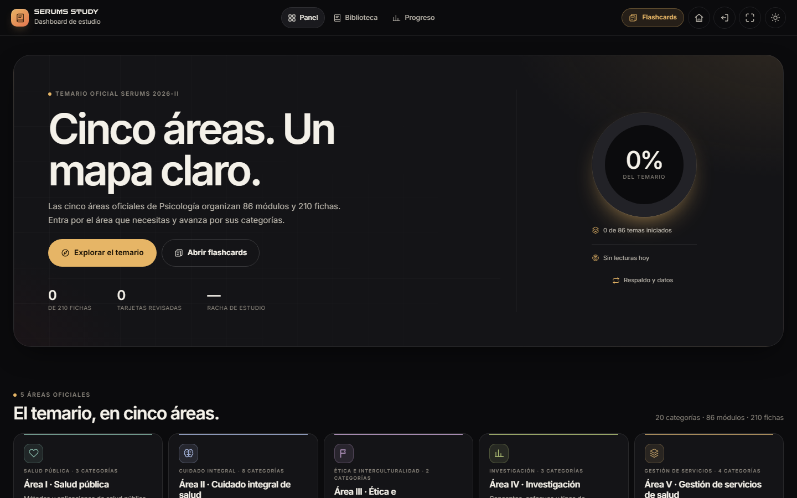
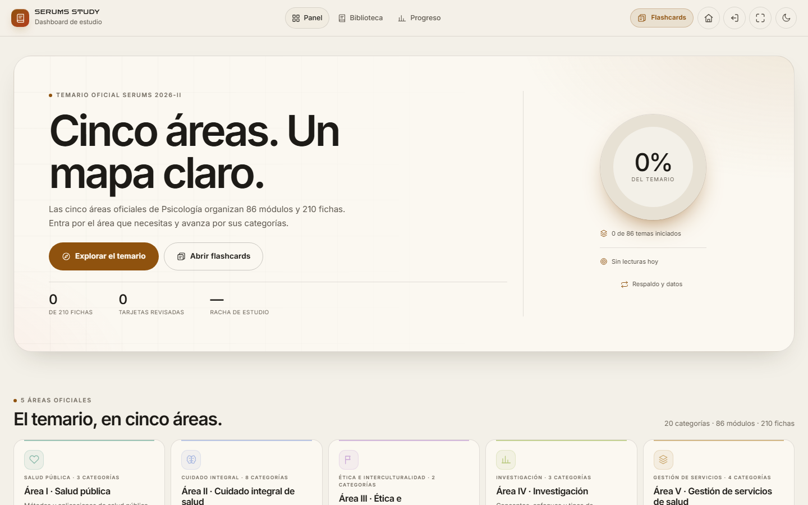
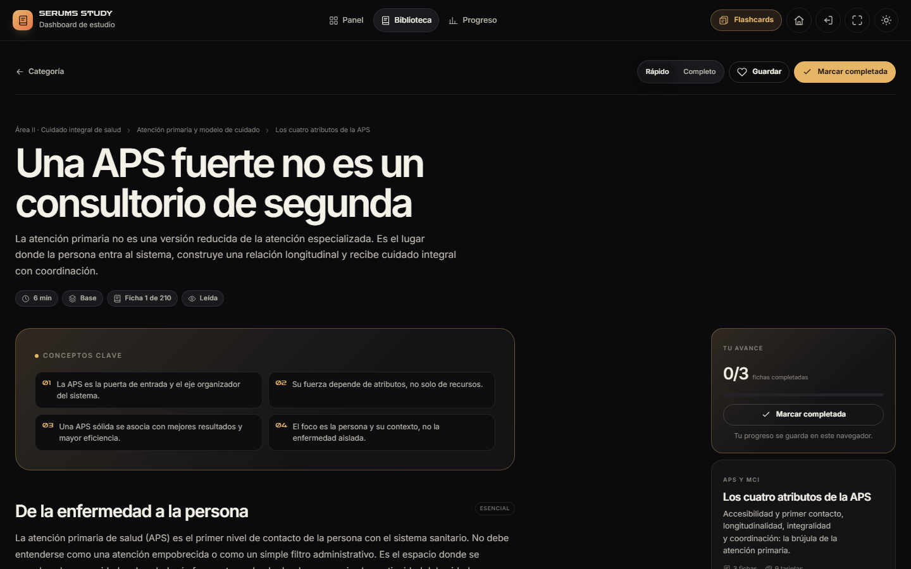
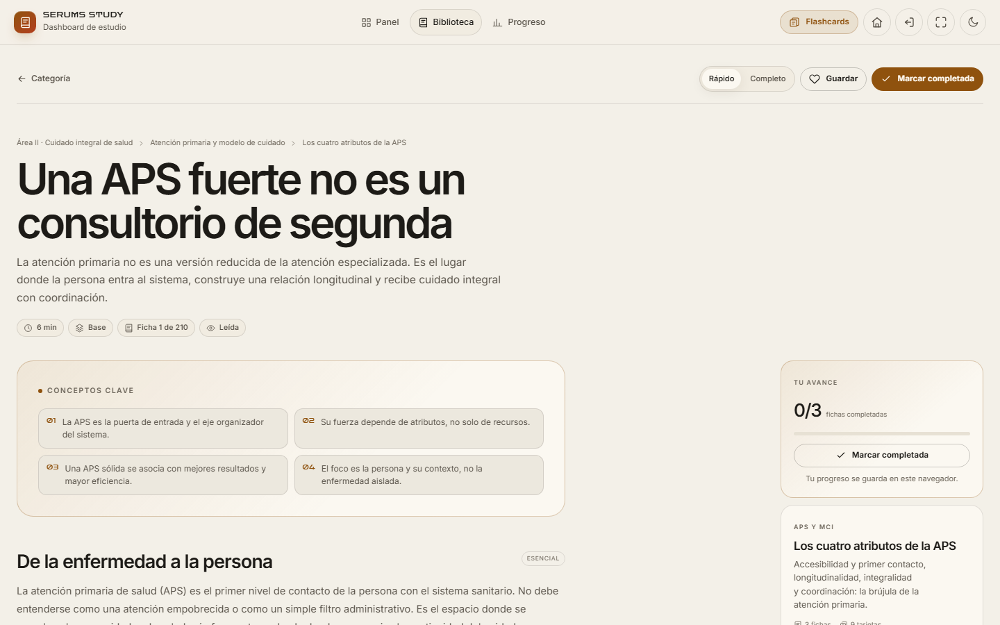
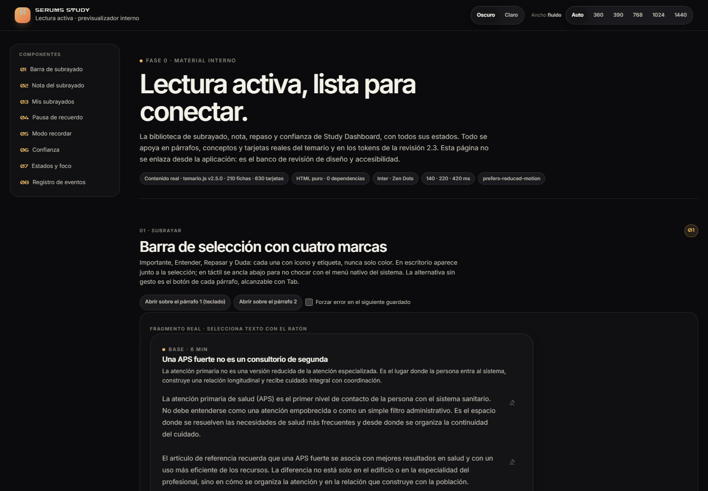
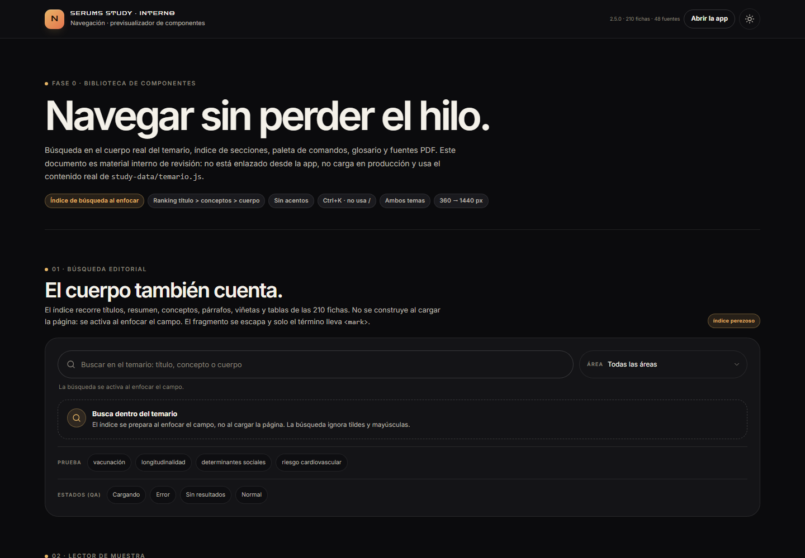

# Study Dashboard 2.3.0 · Fase 0 — Cimientos y correcciones

**Proyecto:** SERUMS STUDY · ZARCONT  
**Entrega:** Fase 0 de «Estudio activo»  
**Fecha:** 9 de noviembre de 2026 · America/Lima  
**Versión:** 2.3.0 (en desarrollo; esta fase no se declara como release final)  
**Alcance:** contratos y arquitectura de extensión, persistencia v2, respaldo, tokens y accesibilidad, navegación secundaria, bases de contenido derivado, bibliotecas internas de lectura activa y navegación, modelo de planificación.

---

## 1. Resultado de la fase

La Fase 0 deja una base comprobable para las fases de lectura activa, planificación y repaso. **No se integró todavía ninguna función pública de las fases 1–3.** Las rutas nuevas reservadas existen en el contrato; la única ruta pública nueva es `#/respaldo`.

| Comprobación | Resultado |
|---|---:|
| Suite E2E Study | **26/26 PASS** (`DASH-01…17`, `FLASH-01…09`) |
| Pruebas del store v2 | **15/15 PASS** |
| Pruebas del modelo de planificación | **84/84 PASS** |
| Contraste de tokens | 100 comprobaciones · **0 requeridas fallan** (8 avisos decorativos) |
| axe-core | 24 auditorías · **0 violaciones** · 0 nodos afectados |
| Capturas y responsive | 24 capturas · **0 px de overflow** · 0 controles táctiles < 44 px |
| Matriz propia de 6 viewports × 2 temas | 72/72 rutas y estados con `scrollWidth === innerWidth` y `h1` |
| Línea base E2E anterior | 18/18 PASS → 26/26 PASS; sin archivos cambiados durante la corrida final |

Las pruebas finales se ejecutaron en Chrome headless sobre el servidor estático local. No sustituyen una prueba manual con NVDA/VoiceOver ni con hardware iOS/Android real.





---

## 2. Qué se construyó

### 2.1 Cimientos de la app

- `window.StudyApp` con `registerModule`, rutas de módulo, ciclo `init` / `mount` / `onRoute` / `onSheetRender` / `onKeydown` / `unmount`, error boundary y contexto común.
- Bus de eventos con `on`, `off`, `once`, `emit` y eventos de ruta, ficha, store, respaldo y colecciones v2. El registro de atajos comparte la misma protección de campos editables que `/`.
- Memoria de scroll por ruta canónica para Biblioteca y Progreso; las fichas conservan su posición propia y las rutas de módulo pueden declarar `restoreScroll`.
- Navegación secundaria **Más** (≤900 px): la appbar baja de 9 a 5 controles visibles (marca, Panel, Biblioteca, Progreso y Más). El panel reúne Flashcards, Respaldo, Inicio, HUB, pantalla completa y tema, con foco atrapado, `Esc`, velo y foco devuelto.
- Aviso persistente de almacenamiento (H19), sin que el render de la vista lo reemplace.

### 2.2 Persistencia y respaldo

- Esquema **v2 aditivo** sobre la misma clave `study-state-v1` y la misma IndexedDB `study-serums` v1. Se conservan `sheets`, `cards`, sesiones, actividad, historial y `flashSession`; las cajas de repaso de Study Flashcards no cambian.
- Nueve colecciones con tombstones: `annotations`, `doubts`, `sheetConfidence`, `sheetReview`, `recall`, `userCards`, `plan`, `weekly`, `factsKnown`.
- `resetAt` impide que una pestaña antigua resucite progreso tras un borrado total. La fusión conserva el tombstone aunque el registro vivo tenga fecha posterior.
- Exportar/importar JSON versionado con validación, vista previa, fusión/reemplazo, confirmación de reemplazo, copia previa obligatoria y límite de 12 MB. Ruta pública **`#/respaldo`**.
- Borrado total con dos pasos, checkbox de comprensión y copia `study-backup-preclear-v1`. El tema, el modo de lectura y las preferencias se conservan.
- Recordatorio discreto cada 7 días en Panel/Progreso, solo con actividad real, con acciones Exportar y Ahora no.
- H13: el historial mueve al principio la ficha repetida y no la duplica.

### 2.3 Datos derivados

`tools/build-derived.js` genera de forma determinista, en un sandbox `vm`, siete archivos bajo `study-data/derived/`:

| Archivo | Contenido | Tamaño |
|---|---|---:|
| `search.json` | 10.014 entradas normalizadas sin acentos, con ficha/sección/párrafo/fila | 2.378.627 B |
| `glossary.json` | 57 definiciones explícitas | ~29 KB |
| `facts.json` | 261 datos numéricos de tablas | ~100 KB |
| `warnings.json` | 451 avisos/precauciones y distinciones explícitas | ~188 KB |
| `related.json` | 116 vínculos con evidencia textual | ~102 KB |
| `report.json` | incluidos, descartados y motivos de validación | ~4,5 KB |
| `manifest.json` | versión, hashes, tamaños y conteos | ~2 KB |

Los índices **no se cargan al arrancar**. `StudyDerived.load()` los pide por HTTP cuando una función los necesita, los cachea y conserva `fragment(entry)`, `get`, `state` y `reset`. Las definiciones inferidas se descartan; solo se publica lo que aparece en el texto con referencia a ficha y sección.

### 2.4 Diseño y accesibilidad

- Tokens semánticos de tema claro para éxito y peligro; cuatro subrayados (`importante`, `entender`, `repasar`, `duda`) con `-bg`, `-line` e `-ink`, verificados en ambos temas.
- El acento claro pasó de `#9A5B12` a `#8F520E` para que badges y números decorativos superen 4,5:1 en fondos compuestos.
- H2: nombres accesibles dinámicos + texto visualmente oculto en botones del lector móvil.
- H5: tablas desplazables enfocables con `role="region"` y etiqueta.
- H9: marca con nombre accesible coincidente con el texto visible.
- H11: recomendación única a ancho completo; H12: sin cabecera duplicada en la ruta de área; H14: pista de `/` oculta al escribir; H16: objetivos táctiles de 44 px y appbar móvil de 5 controles; H20: foco programático del `h1` sin anillo ámbar.
- `prefers-reduced-motion`, `prefers-contrast: more` y `prefers-reduced-transparency` se respetan en los componentes nuevos.





### 2.5 Material interno de las siguientes fases

- **Lectura activa (Agente 3):** biblioteca visual + `docs/preview-active.html` con barra de subrayado, nota, panel de subrayados, pausa de recuerdo, modo recordar, confianza y estados; sin integrar en la app.
- **Navegación (Agente 5):** `js/nav/*` y `docs/preview-nav.html` con búsqueda en el cuerpo real, índice/scrollspy, paleta Ctrl+K, glosario y panel de fuentes; sin cargarse en producción todavía.
- **Planificación (Agente 4):** `js/plan/plan-model.js` puro y documentado, con ruta de hoy, plan por fecha, dominio, repaso y resumen semanal; 84 pruebas; integración diferida a Fase 2.
- Ambas bibliotecas respetan la identidad visual, ambos temas, teclado, movimiento reducido y prefijos CSS aislados.





---

## 3. Hallazgos del informe

| ID | Estado en Fase 0 | Evidencia |
|---|---|---|
| H1 | **Cerrado** | Tokens de tema claro, contraste 92/92 requeridas y axe sin violaciones |
| H2 | **Cerrado** | Texto accesible + `aria-label` dinámico; DASH-16 |
| H3 | **Cerrado** | `#/respaldo`, exportar/importar/borrar, copia previa, recordatorio; DASH-10 y 15 pruebas del store |
| H4 | **Diferido** | El contenido compartido conserva su carga actual para no romper Flashcards. Los índices nuevos no se descargan al inicio; la división del temario queda para una fase posterior |
| H5 | **Cerrado** | Tabla enfocable, etiquetada y desplazable; DASH-16 |
| H6 | **Cerrado** | Memoria de scroll; DASH-11 |
| H7 | **Cerrado** | «Objetivo superado» en Panel y Progreso; DASH-12 |
| H8 | **Cerrado** | 22 fichas sin ampliación sin selector; DASH-13 |
| H9 | **Cerrado** | Marca accesible; DASH-16 y axe |
| H10 | **Base lista, no cerrado** | Índice de cuerpo probado y componentes de búsqueda diseñados; la UI pública es de la Fase 1 |
| H11 | **Cerrado** | Recomendación única a ancho completo |
| H12 | **Cerrado** | La ruta de área no repite título y métricas |
| H13 | **Cerrado** | `pushHistory` y merge deduplican; DASH-14 |
| H14 | **Cerrado** | Pista `/` oculta mientras hay texto |
| H15 | **Cerrado** | 2.3.0 en app, assets, AUTORIA, metadatos y caché |
| H16 | **Cerrado** | Appbar móvil de 5 controles; DASH-15 |
| H17/H18 | No modificados | Observaciones editoriales de contenido; no se inventó ni se retiró contenido |
| H19 | **Cerrado** | Aviso persistente en vez de render que lo reemplaza |
| H20 | **Cerrado** | Foco programático sin anillo, controles conservan foco visible |

---

## 4. Rendimiento

Suma de los assets locales enlazados por la portada, con gzip nivel 9, sin contar las fuentes de Google:

| Medida | Antes (HEAD) | Ahora | Diferencia |
|---|---:|---:|---:|
| Bytes sin comprimir | 2.801.916 | 2.959.265 | +157.349 (+5,62 %) |
| Gzip | 621.337 | 657.420 | +36.083 (+5,81 %) |
| Contenido del temario | 2.587.623 | 2.587.623 | 0 |

El temario y los PDFs no cambian ni se cargan de otra manera. El aumento es código nuevo de producto (app, store, tokens, respaldo y estilos), no contenido derivado: **los 2,8 MB de índices derivados quedan fuera de la carga inicial y solo se piden bajo demanda**. Study Flashcards no recibe código nuevo de producto; solo se actualizan sus tokens de caché.

Esta fase no cierra H4. Si el criterio de release exige reducir la carga inicial en términos absolutos, la división del temario por área debe planificarse junto con Study Flashcards para conservar el mismo origen de datos y el mismo progreso.

---

## 5. Capturas

Las 24 capturas están en [`capturas/`](capturas/). Incluyen Panel, Biblioteca, Ficha, Progreso y Respaldo en ambos temas, a 1440×900 y 390×844; la hoja **Más** abierta en ambos temas; y dos pasadas con movimiento reducido. Todas fueron medidas con 0 px de overflow y, en móvil, 0 controles táctiles por debajo de 44 px.

- [Panel móvil oscuro](capturas/panel-oscuro-390x844.png)
- [Panel móvil claro](capturas/panel-claro-390x844.png)
- [Más móvil oscuro](capturas/mas-abierto-oscuro-390x844.png)
- [Respaldo oscuro](capturas/respaldo-oscuro-1440x900.png)
- [Respaldo claro](capturas/respaldo-claro-1440x900.png)
- [Ficha móvil oscura](capturas/ficha-oscuro-390x844.png)

---

## 6. Pruebas y evidencias

```powershell
node --test study-dashboard/tests/data              # 15/15
node --test study-dashboard/tests/unit/plan         # 84/84
node tools/build-derived.js                         # determinista
node tools/qa/contraste.mjs                         # 0 fallos requeridos
node tools/qa/axe-audit.mjs                         # 24 auditorías, 0 violaciones
node tools/qa/capturas.mjs                          # 24 capturas, 0 overflow
node tools/qa/run-qa.mjs                            # 3/3 bloques en verde
& '…\node.exe' tests/e2e/run.mjs --suite=dash,flash --quick  # 26/26
```

Evidencias publicadas:

- [`evidencias/e2e-run-quick.json`](evidencias/e2e-run-quick.json) — salida completa de DASH/FLASH.
- [`evidencias/axe.json`](evidencias/axe.json) — matriz axe por ruta, tema y viewport.
- [`evidencias/contraste.json`](evidencias/contraste.json) — 100 comprobaciones de contraste.
- [`evidencias/resumen.json`](evidencias/resumen.json) — resumen del runner de QA.
- [`../../docs/CONTRATOS.md`](../../docs/CONTRATOS.md) — API de módulos, rutas, eventos, store v2 y tokens.
- [`../../docs/INFORME-FASE0-DATOS.md`](../../docs/INFORME-FASE0-DATOS.md) — detalle de persistencia, respaldo y derivados.
- [`../../docs/PLAN-MODELO.md`](../../docs/PLAN-MODELO.md) — fórmulas y límites del modelo de planificación.
- [`../../docs/ACTIVE-CONTRATO.md`](../../docs/ACTIVE-CONTRATO.md) — API y contratos de integración de lectura activa.
- [`../../docs/NAV-CONTRATO.md`](../../docs/NAV-CONTRATO.md) — API de navegación para Fase 1.
- [`../../docs/preview-active.html`](../../docs/preview-active.html) y [`../../docs/preview-nav.html`](../../docs/preview-nav.html) — previsualizadores internos.
- [`../../../tools/qa/salida/INFORME-QA-FASE0.md`](../../../tools/qa/salida/INFORME-QA-FASE0.md) — informe completo de diseño, accesibilidad y QA.

### Línea base

Antes de integrar los cambios, `tests/e2e/run.mjs --suite=dash,flash --quick` dio **18/18 PASS**. La corrida final estable dio **26/26 PASS** y no registró archivos cambiados durante la ejecución.

Se añadió una verificación de integración del HUB (`--suite=hub,content --quick`). Los casos que conectan con Study pasan, incluidos HUB-04 (Study Dashboard), HUB-05 (Study Flashcards), HUB-14 (snapshot sembrado) y HUB-15 (reanudación). En esa misma corrida, HUB-06 y CONTENT-04/05 fallaron al no arrancar **SERUMS QUEST** en Chrome headless; esa app no se modificó en esta fase y el fallo es ajeno a los cambios de Study. Las integraciones de Study y Flashcards verificadas por HUB-04/05/14/15 no fallan.

---

## 7. Supuestos tomados

1. La app se sirve por HTTP desde la raíz del repositorio; `file://` no comparte storage entre Study Dashboard y Flashcards.
2. Los índices derivados se cargan al usarse, nunca en el arranque. Su contrato permite que la Fase 1 los consuma sin volver a tocar la app base.
3. La Fase 0 no integra subrayados, notas, planificación ni búsqueda pública; solo entrega cimientos verificables y previsualizadores internos.
4. Los colores de subrayado se usan con etiqueta/icono además del color; el texto sobre resaltados translúcidos mantiene contraste.
5. `axe` y `contraste` se ejecutan en Chrome headless de Windows. Los fondos con degradado se remiden en la página cuando axe no puede resolverlos.
6. El fixture v1 del store se considera representativo de un estado real; cualquier importación de una copia desconocida sigue validándose antes de aplicarse.
7. La indexación del cuerpo no define contenido clínico: conserva citas y referencias del temario y descarta definiciones no explícitas.

---

## 8. Riesgos conocidos y deuda

- **H4 sigue abierto:** la carga inicial creció 36 KB gzip por código nuevo; no se divide el temario en esta fase para no romper Flashcards ni el snapshot del HUB.
- **H10 sigue abierto:** la búsqueda en el cuerpo tiene índice y componentes probados, pero su UI se integra en Fase 1.
- **Copias de seguridad:** si la cuota de `localStorage` no permite la copia previa, importar/borrar se cancela con un error visible. Si falla la escritura principal después, el store mantiene el estado en memoria y no lanza; no hay recuperación mágica ante un almacenamiento roto.
- **Derivados:** los 2,8 MB de índices son datos de sesión bajo demanda; buscarlos por primera vez en una red lenta puede tardar. `search.json` (2,38 MB) es el mayor y no se descarga al inicio.
- **Pruebas humanas:** no se probó NVDA, VoiceOver, Safari iOS ni Android físico. Los objetivos táctiles se midieron con emulación de puntero grueso.
- **Axe incompleto:** el único nodo «incomplete» es `aria-controls` del botón Más apuntando a un diálogo cerrado; el destino existe y DASH-15 comprueba que se resuelve al abrir. No es una violación.
- **H17/H18:** el conteo editorial de módulos y las fuentes sin cita siguen como observaciones; no se alteró contenido para cerrarlas.

---

## 9. Estado de entrega

La Fase 0 queda **terminada y detenida a la espera de aprobación**. No se ha avanzado a la Fase 1: no hay subrayados, notas, pausa de recuerdo, búsqueda pública ni plan dentro de la interfaz de producción. Los archivos de la Fase 1 están preparados como bibliotecas internas y contratos.

---

© 2026 ZARCONT — Documento interno del proyecto.
