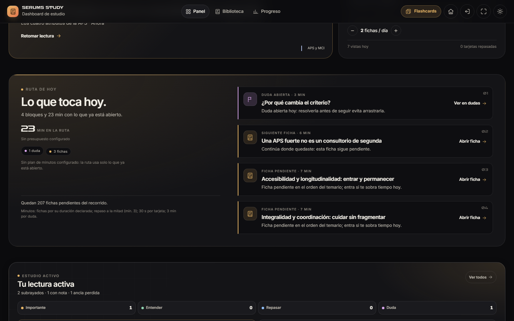
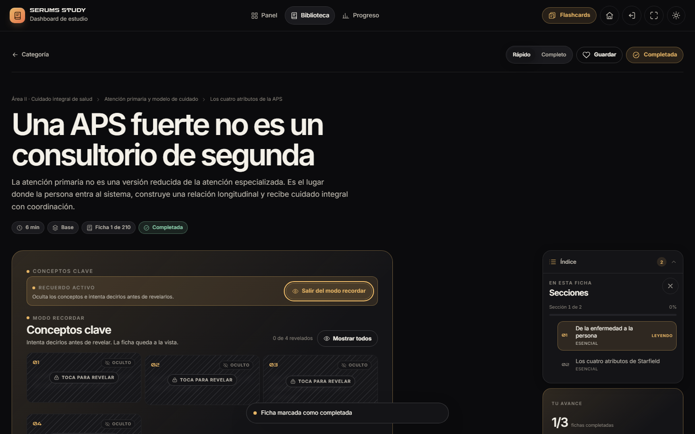
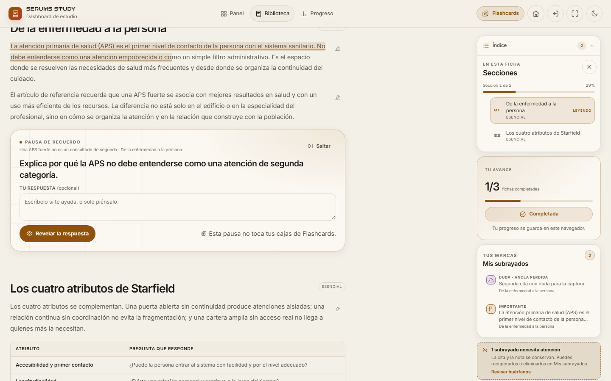
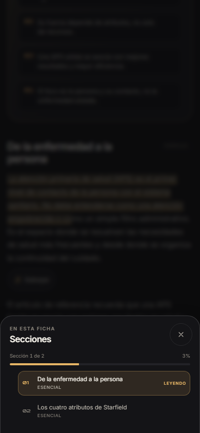

# Study Dashboard 2.3.0 · Fase 1 — Lectura activa, búsqueda y Ruta de hoy inicial

**Proyecto:** SERUMS STUDY · ZARCONT  
**Fecha:** 10 de noviembre de 2026 · America/Lima  
**Versión:** 2.3.0  
**Estado:** Fase 1 terminada y detenida a la espera de aprobación. **No se inició la Fase 2.**  
**Base:** Fase 0 en `informe/fase0/`; contratos en `docs/CONTRATOS.md` y `docs/CONTRATOS-FASE1.md`.

---

## 1. Resultado

Esta fase convierte el lector en una herramienta de estudio activo sin sustituir a Study Flashcards. El alumno puede subrayar, anotar, generar sus propias tarjetas, dudar, recuperar, buscar en todo el cuerpo del temario, orientarse con la paleta y ver una primera Ruta de hoy en el Panel.

| Comprobación | Resultado |
|---|---:|
| E2E Study `DASH-01…30` + `FLASH-01…09` | **39/39 PASS** · 0 FAIL · 0 SKIP · `stable:true` |
| Pruebas del store v2 | **25/25 PASS** |
| Pruebas del modelo de planificación | **99/99 PASS** |
| axe-core | **66 auditorías · 0 violaciones · 0 pendientes** · 9 estados abiertos |
| Contraste | **100 comprobaciones · 0 requeridas fallan** |
| Capturas | **110 PNG** · 6 viewports · 12 estados · 0 overflow |
| Controles táctiles | 0 controles requeridos < 44 px en puntero grueso |
| Carga inicial | 3.436,2 KB / 28 peticiones; **0 derivados al arrancar** |

La evidencia E2E definitiva es `AUDIT/evidencias/phase1-release/run-quick.json`: la corrida no registró archivos cambiados durante su ejecución.

---

## 2. Qué se construyó

### 2.1 Lectura activa

- **Subrayados con cuatro marcas**: Importante, Entender, Repasar y Duda. La barra de selección tiene icono y etiqueta, nota opcional (280 caracteres), `Esc`, selección por teclado y botón alternativo por párrafo.
- **Anclaje robusto**: cita + prefijo + sufijo + sección + índice de párrafo. Si el texto cambia, el subrayado queda visible como **huérfano** en el panel y puede recuperarse o eliminarse; no se pierde en silencio.
- **Notas**: edición de la nota asociada, conservando la cita; Guardar/Cancelar, error y estado guardado.
- **Tarjetas propias**: se crean desde un subrayado con el frente tomado de la cita y reverso escrito por el usuario. Se pueden ver y editar desde «Mis tarjetas». Editar una tarjeta vinculada ya no crea un duplicado (verificado con un ciclo crear → editar → guardar).
- **Pausa de recuerdo**: pregunta de una tarjeta real de la ficha, respuesta libre opcional, Revelar, tres autoevaluaciones y Saltar siempre visible. Interruptor persistente y frecuencia 1/2/3. **No toca las cajas de Flashcards**; escribe únicamente `recall`.
- **Modo recordar**: oculta los conceptos clave con velo/patrón, permite revelarlos por toque/tecla, contador y «Mostrar todos». No depende solo del color.
- **Confianza al completar**: Lo domino / Más o menos / No lo entendí, opcional, editable y persistente; no bloquea la lectura.
- **Bandeja de dudas** `#/dudas`: crear desde el subrayado Duda, resolver/reabrir sin borrar el subrayado, filtros Abiertas/Resueltas/Todas, búsqueda y salto al contexto. Contador en el Panel.
- **Panel global** `#/subrayados`: filtros por color, ficha/área y búsqueda sin acentos; cita, fecha, nota, huérfanos, recuperación, «Ir al contexto», tarjetas propias y estados vacío/error.
- **Resumen en el Panel**: número de subrayados por color, dudas abiertas y tarjetas propias, con enlaces directos.
- **Atajos del lector**: `n`/`p` ficha siguiente/anterior, `c` completar, `s` párrafo/subrayar, `r` modo recordar, `?` ayuda; `1–4` eligen color con la barra abierta. Se desactivan al escribir y en diálogos; no chocan con `/` ni con `Ctrl+K`.

### 2.2 Búsqueda y navegación

- **Búsqueda en el cuerpo** en `#/biblioteca` con el índice derivado real. Sin acentos, ranking título > conceptos > cuerpo, filtro por área, fragmento con término resaltado, recuento, tiempo y estados vacío/cargando/error.
- **Índice cargado al enfocar**, nunca al arrancar. Primera petición de `search.json` solo al enfocar el campo; fallback declarado a indexación local si el JSON falla.
- **Índice flotante de secciones** con scrollspy, una sola sección «Leyendo», barra de avance y hoja inferior accesible en móvil. El salto mueve el foco al `h2` sin ensuciar la URL.
- **Paleta Ctrl+K / ⌘K** con fichas, áreas, categorías, vistas reales y acciones (tema, respaldo). Combobox accesible, foco modal, `Esc`, retorno al disparador. El botón «Más» abre la misma paleta.
- **Fichas relacionadas** con hasta 4 sugerencias: primero evidencia textual de `related.json`, luego el respaldo estructural aprobado (mismo tema, después misma categoría), con motivo explícito. Carga bajo demanda; no inventa relaciones ni block vacío si no hay candidatos.
- La búsqueda normal de la biblioteca se oculta de forma explícita mientras hay consulta y se restaura al limpiarla; `hidden` + CSS para que no dependa solo de un estilo.

### 2.3 Ruta de hoy inicial

- Bloque editorial en el Panel, después de «Continuar donde lo dejaste», con:
  - siguiente ficha/pendientes del recorrido;
  - dudas abiertas;
  - repasos de ficha y tarjetas vencidas;
  - tiempo estimado declarado y motivo de cada bloque;
  - presupuesto del plan si ya existe, sin crear ni editar el plan en Fase 1.
- Estados reales: `lista`, `sinActividad`, `alDia`, `sinTiempo` y `error`. Sin métricas inventadas.
- El bloque es una pieza reutilizable de `StudyPlanToday` para que Fase 2 lo convierta en la Ruta de hoy completa. No carga `plan-model.js` al arrancar.
- La antigua sección de recomendaciones ahora usa el kicker **Sugerencias**, evitando dos «Ruta de hoy» seguidos.

### 2.4 Store, persistencia y privacidad

- `annotations.list({areaId})` resuelve el área desde el contenido y combina con `sheetId`/`color`/tombstones.
- `recall.add/remove` emite `recall:changed` con `{sheetId, id, rating}` por DOM y por `StudyApp.events`.
- Optimización de fusión entre pestañas para estados grandes, sin cambiar la semántica de tombstones ni `resetAt`.
- Las preferencias de lectura (`recallPause`, `recallEvery`, `shortcuts`) viven en `study-active-prefs-v1`, fuera del estado exportado; un `clearAllProgress` no las borra.
- Se mantiene el esquema v2 y la compatibilidad completa con Study Flashcards: mismas claves, misma IndexedDB, mismas cajas de tarjetas.

---

## 3. Capturas

Las 110 capturas completas están en `tools/qa/salida/capturas/` y la selección publicada en [`capturas/`](capturas/). Cubren Panel, Biblioteca, Ficha, Progreso, Subrayados, Dudas y Respaldo; ambos temas; 360, 390, 768, 1024, 1440 y 844×390; y los estados Ruta de hoy, actividad, relacionadas, activa, pausa, barra de selección, búsqueda, paleta, hoja de índice, Más y movimiento reducido.









- [Búsqueda en el cuerpo](capturas/biblioteca-busqueda-oscuro-1440x900.png)
- [Mis subrayados con datos](capturas/subrayados-datos-claro-1440x900.png)
- [Bandeja de dudas](capturas/dudas-datos-oscuro-1440x900.png)
- [Paleta de comandos](capturas/paleta-oscuro-390x844.png)
- [Más en móvil](capturas/mas-abierto-oscuro-390x844.png)

---

## 4. Verificación

```powershell
node --test "study-dashboard/tests/data/**/*.test.js"       # 25/25
node --test "study-dashboard/tests/unit/plan/**/*.test.mjs" # 99/99
node tools/qa/run-qa.mjs                                    # 4/4 bloques
node tests/e2e/run.mjs --suite=dash,flash --quick           # 39/39
```

- **E2E:** `DASH-01…30` y `FLASH-01…09`, 39/39. Las 13 pruebas nuevas cubren subrayado/nota/tarjeta, pausa de recuerdo, modo recordar/confianza, dudas, búsqueda con índice perezoso, Ctrl+K, índice/scrollspy/hoja, relacionadas con motivo, Ruta de hoy, atajos del lector y capas táctiles a 360 px y 844×390.
- **axe:** 66 auditorías en 7 rutas, 2 temas, 2 viewports y 9 estados abiertos; 0 violaciones. 530 nodos de contraste que axe dejó incompletos se remidieron en página; 0 fallos.
- **Contraste:** 100 comprobaciones de tokens, 0 requeridas fallan. Los tres defectos de contraste encontrados en módulos se corrigieron y re-auditaron.
- **Capturas:** 110 PNG, 6 viewports, 12 estados, 0 desbordes, 0 controles táctiles por debajo de 44 px y appbar móvil de 5 controles.
- **Teclado real:** `/` enfoca la búsqueda de biblioteca; Ctrl+K abre la paleta; Esc cierra y devuelve el foco; en el lector `?` abre la ayuda; los atajos se desactivan al escribir. No se sustituyen por `.focus()` sintético en las pruebas de flujo.
- **Correcciones de integración:** `initModule` se ejecuta de verdad; la barra de selección usa `view.selection`; la pausa no toca `cards`; `ucard:from` edita la tarjeta vinculada sin duplicar; el índice muestra una sola sección «Leyendo»; los enlaces de la paleta a `#/subrayados` y `#/dudas` tienen destino real.

### Evidencias principales

- [`evidencias/e2e-run-quick.json`](evidencias/e2e-run-quick.json) y [`run-meta.json`](evidencias/run-meta.json) — corrida E2E final.
- [`evidencias/axe.json`](evidencias/axe.json) — matriz axe de rutas y estados.
- [`evidencias/contraste.json`](evidencias/contraste.json) — tokens.
- [`evidencias/peso.json`](evidencias/peso.json) — carga inicial y derivados.
- [`evidencias/capturas.json`](evidencias/capturas.json) — inventario de las 110 capturas.
- [Informe completo de QA](../../../tools/qa/salida/INFORME-QA-FASE1.md).
- [Contratos de Fase 1](../../docs/CONTRATOS-FASE1.md), [contrato de lectura activa](../../docs/ACTIVE-CONTRATO.md), [contrato de navegación](../../docs/NAV-CONTRATO.md), [modelo de planificación](../../docs/PLAN-MODELO.md).

---

## 5. Rendimiento

Medición real con Chrome headless, caché desactivada, `transferSize` del mismo origen:

| Medida | Fase 1 | Equivalente sin assets de Fase 1 | Delta |
|---|---:|---:|---:|
| Transferencia de la portada | 3.436,2 KB | 2.901 KB | **+535,3 KB** |
| Peticiones | 28 | 13 | +15 |
| Derivados al arrancar | 0 | 0 | — |
| `search.json` | 1 petición al enfocar la búsqueda | — | — |
| `related.json` | 0 en portada/biblioteca; 1 al abrir ficha | — | — |

El contenido compartido (`temario.js`, 2,5 MB) no cambió. El aumento corresponde al código y CSS de lectura activa, navegación y Ruta de hoy, cargados porque la portada, el lector y la paleta los necesitan. **H4 sigue abierto:** no se dividió el temario inicial; se hará en una fase posterior sin romper Study Flashcards. Los índices derivados (2,4 MB de búsqueda y el resto de referencias) sí permanecen fuera de la carga inicial y se piden bajo demanda.

---

## 6. Hallazgos y pendientes

- **H10 cerrado:** búsqueda en el cuerpo real, con ranking, filtro por área, fragmento y carga del índice al enfocar.
- **H19 / H20 / H1–H3 / H5–H9 / H11–H16 / H20** se mantienen cerrados tras la regresión de Fase 1.
- **H4 abierto:** división del temario inicial. El código nuevo de Fase 1 añade +535 KB de transferencia; no se disfraza como cero.
- **H17/H18** siguen como observaciones editoriales; no se tocó el contenido.
- **Revisión humana pendiente:** NVDA/VoiceOver y un iPhone/Android reales; Chrome headless no cubre lectores de pantalla ni el menú nativo de selección.
- Los casos `aria-valid-attr-value` incompletos de la paleta y del botón Más se revisaron a mano: los IDREF existen y se resuelven al abrir; no son violaciones.
- No se inició Fase 2: `#/ruta`, `#/plan`, `#/dominio` y `#/repaso` siguen reservadas.

---

## 7. Supuestos

1. La app se sirve por HTTP desde la raíz del repositorio; `file://` no comparte almacenamiento entre Study Dashboard y Study Flashcards.
2. Las preferencias de lectura son locales y no forman parte del export/import de progreso; el progreso canónico sigue en `study-state-v1`.
3. El respaldo estructural de fichas relacionadas se acepta como motivo factual: mismo tema o misma categoría. La evidencia textual se muestra primero.
4. La pausa de recuerdo usa tarjetas reales de la ficha y nunca modifica las cajas de Study Flashcards.
5. «Ruta de hoy» de Fase 1 es un bloque informativo/reutilizable; el editor de plan y las rutas de planificación son Fase 2.
6. Las pruebas se ejecutaron en Chrome headless 157 de Windows; falta la validación humana con lectores de pantalla y hardware móvil real.
7. No se añadieron dependencias npm ni build; axe-core sigue siendo exclusivamente una herramienta de QA en `tools/qa/vendor/`.

---

## 8. Estado de entrega

La Fase 1 queda terminada y **detenida a la espera de aprobación**. No se ha iniciado la Fase 2. No hay funciones a medio integrar en la navegación principal: las rutas nuevas tienen estado vacío real, los módulos fallan de forma controlada y las 39 pruebas pasan.

© 2026 ZARCONT — Documento interno del proyecto.
