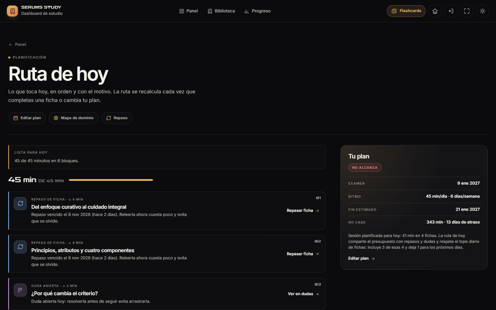
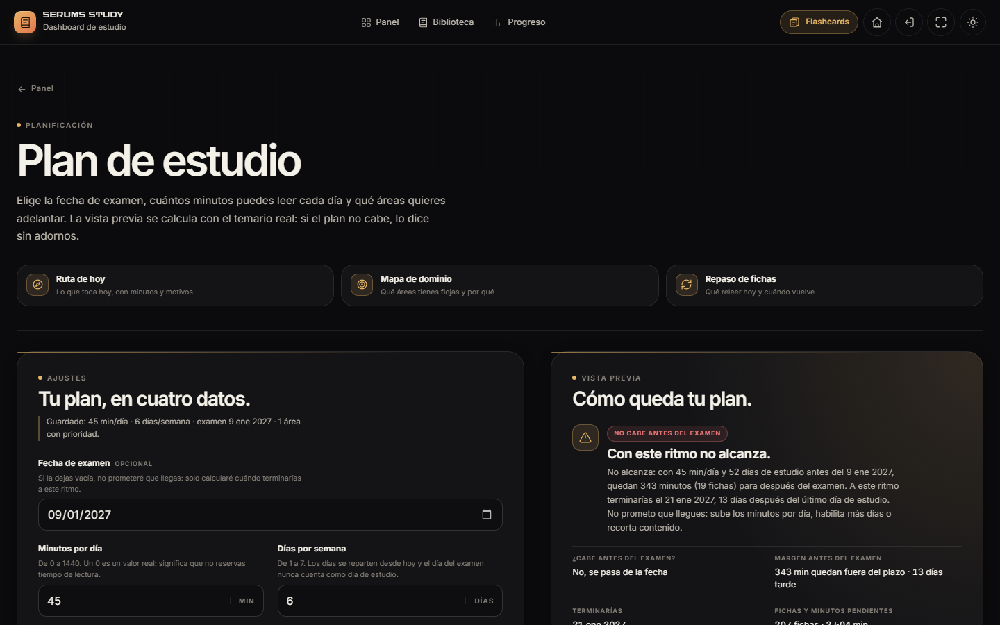
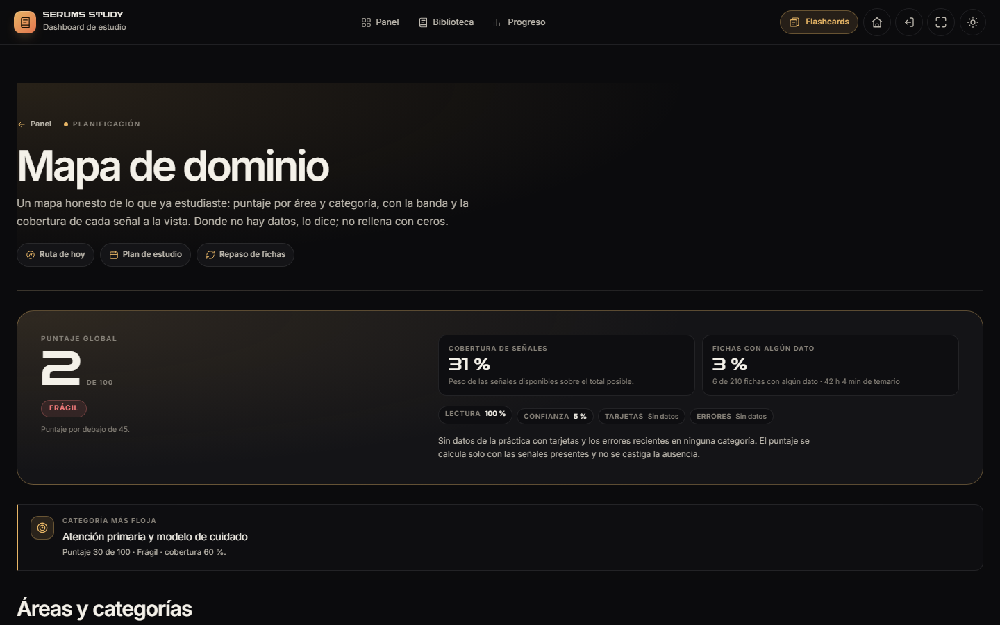
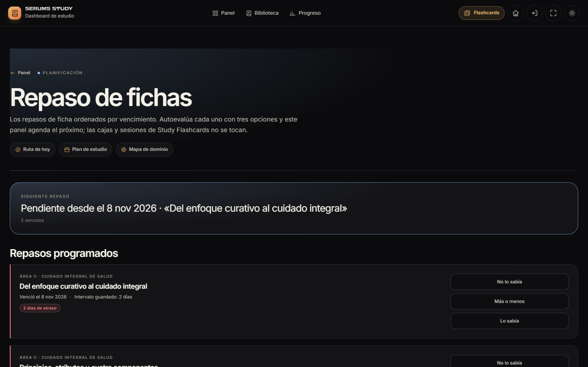

# Study Dashboard 2.3.0 · Fase 2 — Planificación

**Proyecto:** SERUMS STUDY · ZARCONT  
**Fecha:** 10 de noviembre de 2026 · America/Lima  
**Versión:** 2.3.0  
**Estado:** Fase 2 terminada y detenida a la espera de aprobación. **No se inició la Fase 3.**  
**Contrato:** `docs/CONTRATOS-FASE2.md` · **Motor:** `docs/PLAN-MODELO.md` §14.

---

## 1. Resultado

La planificación deja de ser un modelo puro y se integra en cuatro rutas operativas. El motor se carga **solo** cuando una de ellas se abre; la portada, la biblioteca y el lector no descargan `plan-model.js`.

| Comprobación | Resultado |
|---|---:|
| E2E Study `DASH-01…38` + `FLASH-01…09` | **47/47 PASS** · 0 FAIL · 0 SKIP · `stable:true` |
| Modelo + integración de planificación | **118/118 PASS** |
| Pruebas del store v2 | **29/29 PASS** |
| axe-core | **100 auditorías · 0 violaciones · 0 pendientes** · 12 estados |
| Contraste remedido | **782 nodos incompletos · 0 fallos** |
| Capturas | **176 PNG** · 6 viewports · 15 estados · 0 overflow |
| Carga inicial | **3.727 KB / 37 peticiones**; Fase 1: 3.441,6 KB; Fase 0: 2.903,5 KB |
| Delta de Fase 2 | **+285,4 KB** · `plan-model.js` 0 peticiones al arrancar, 1 al abrir `#/ruta` (110 ms) |

La evidencia E2E definitiva es `AUDIT/evidencias/agente6-fase2-final3/run-quick.json`: la corrida terminó 47/47 con `stable:true`.

---

## 2. Qué se construyó

### 2.1 Runtime compartido

`js/plan/plan.runtime.js` es el único puente entre contenido, store y modelo:

- Construye el input con las 210 fichas, sus áreas/categorías, estados de lectura, confianza, tarjetas, recuerdos, repasos y dudas.
- `ensureModel()` inyecta `plan-model.js` una sola vez y solo cuando una vista lo pide.
- No escribe en el store ni registra rutas; expone formato, escape e iconos.
- La carga falla de forma controlada: las vistas muestran error y reintento, sin romper el resto de la app.

### 2.2 `#/ruta` · Ruta de hoy completa

- Presupuesto real, estado del plan (`ahead`, `onTrack`, `behind`), fecha estimada, minutos que no caben y sesión planificada.
- Ítems con tipo, minutos, motivo y acción: repaso → `#/repaso`, ficha → `#/ficha/:id`, duda → `#/dudas`, tarjetas → Study Flashcards.
- Estados sin plan, sin presupuesto, 0 minutos, todo completado y error; señales abiertas cuando no hay presupuesto.
- Diferencia explícita entre la **sesión planificada** y la **ruta recortada** por topes, para no mostrar dos cifras contradictorias.
- Resumen semanal real al pie; se guarda con `StudyStore.weekly.save` y no duplica la semana.
- Enlaces directos a `#/plan`, `#/dominio` y `#/repaso`.

### 2.3 `#/plan` · Editor del plan

- Fecha de examen opcional, minutos/día (0 es un valor explícito), días/semana y prioridad por las cinco áreas oficiales (1 / 1,5 / 2).
- Vista previa con `buildPlan`: estado, fecha estimada, margen/atraso, fichas y minutos pendientes, después del examen, cobertura y sesión.
- Validación por campo, estado en vivo, guardado con `StudyStore.plan.save` y `areaPriority`.
- «Quitar plan» con diálogo accesible, foco contenido, `Esc` y confirmación; **no borra el progreso**.
- No pisa un borrador sucio ante cambios externos; se sincroniza cuando no hay cambios pendientes.

### 2.4 `#/dominio` · Mapa de dominio

- Puntaje global y por área/categoría con banda textual, medidor y cobertura de señales.
- Cobertura de fichas separada de la cobertura de señales; explica qué falta y no convierte una ausencia en un cero.
- Señala el punto más flojo cuando la cobertura lo permite.
- Estado vacío real sin datos; nunca rellena con cifras inventadas.

### 2.5 `#/repaso` · Repaso espaciado de fichas

- Repasos programados ordenados por vencimiento, con área, atraso e intervalo guardado.
- Tres autoevaluaciones (`No lo sabía`, `Más o menos`, `Lo sabía`); el próximo vencimiento sale de `nextSheetReview` y se guarda con `sheetReview.save`.
- Sección productiva «Fichas leídas sin repaso programado»: fichas completadas con confianza declarada y sin repaso permiten **programar la primera revisión**. Sin confianza, se explica y se enlaza a la ficha para declararla; no se inventa una escala.
- `cards` y `flashSession` permanecen intactos; esta ruta no toca las cajas de Study Flashcards.

### 2.6 Navegación y datos

- **Más → Planificación** con los cuatro enlaces y la appbar móvil intacta en cinco controles.
- Paleta Ctrl+K con las cuatro vistas (10 vistas en total).
- El bloque Ruta de hoy del Panel tiene «Ver ruta completa» y los repasos apuntan a `#/repaso`.
- `StudyStore.plan.save` conserva `areaPriority` de estados v1/v2, en guardados parciales, export/import y tombstones.
- `StudyStore.urls.appUrl` resuelve la raíz común entre apps; ya no genera `/study-dashboard/study-flashcards/…`.

---

## 3. Capturas

La galería completa está en `tools/qa/salida/capturas/` (176 PNG) y la selección publicada en [`capturas/`](capturas/).









- [Ruta de hoy sin plan](capturas/ruta-claro-1440x900.png)
- [Plan en móvil](capturas/plan-con-plan-claro-390x844.png)
- [Dominio en móvil](capturas/dominio-con-datos-claro-390x844.png)
- [Más → Planificación](capturas/mas-planificacion-oscuro-390x844.png)

---

## 4. Verificación

```powershell
node --test "study-dashboard/tests/unit/plan/**/*.test.mjs"  # 118/118
node --test "study-dashboard/tests/data/**/*.test.js"       # 29/29
node tools/qa/run-qa.mjs                                    # 4/4 bloques
node tests/e2e/run.mjs --suite=dash,flash --quick           # 47/47
```

- **DASH-31…38:** carga perezosa del modelo y reintento; ruta con/sin plan; editor + prioridad + borrado; dominio vacío/con señales; repaso y `sheetReview` sin tocar Flashcards; resumen semanal sin duplicados; Más/paleta/enlace del Panel; 6 viewports y 44 px.
- **axe:** 100 auditorías en 7 rutas, 2 temas, 2 viewports y 12 estados abiertos; 0 violaciones y 0 pendientes. 782 nodos de contraste incompletos se remedieron en página.
- **Regresión:** las 30 pruebas `DASH-01…30` y las 9 `FLASH-01…09` siguen verdes; no se relajó ninguna aserción.
- **Estados abiertos:** la corrida no cambió archivos (`stable:true`).

### Evidencias

- [`evidencias/e2e-run-quick.json`](evidencias/e2e-run-quick.json) y [`run-meta.json`](evidencias/run-meta.json) — E2E final.
- [`evidencias/axe.json`](evidencias/axe.json) — matriz axe.
- [`evidencias/peso.json`](evidencias/peso.json) — carga inicial y `plan-model.js` bajo demanda.
- [`evidencias/capturas.json`](evidencias/capturas.json) — 176 capturas.
- [`ANEXO-QA.md`](ANEXO-QA.md) — informe de QA.
- [Contrato de Fase 2](../../docs/CONTRATOS-FASE2.md) · [modelo de planificación](../../docs/PLAN-MODELO.md).

---

## 5. Rendimiento

| Medida | Valor |
|---|---:|
| Fase 2 (portada) | **3.727 KB / 37 peticiones** |
| Equivalente Fase 1 | 3.441,6 KB / 28 |
| Equivalente Fase 0 | 2.903,5 KB / 13 |
| Delta de Fase 2 | **+285,4 KB / +9 peticiones** |
| `plan-model.js` al arrancar | **0 peticiones** |
| `plan-model.js` al abrir `#/ruta` | **1 petición · 110 ms** |
| `search.json` | solo al enfocar la búsqueda |
| `related.json` | solo al abrir ficha |

El temario compartido no cambió. El crecimiento es código y CSS de las cuatro vistas, no índices derivados. **H4 sigue abierto:** no se dividió la carga inicial del temario. La planificación se mantiene fuera del arranque mediante el runtime y la carga perezosa del modelo.

---

## 6. Límites y decisiones

- **`#/repaso` reconstruye los repasos previos** a partir del intervalo guardado y la confianza actual. Si la confianza cambió desde el último repaso, se declara el supuesto; no se finge un historial que el store no guarda.
- Una ficha leída pero no completada no aparece en «Fichas leídas sin repaso»; se exige `completedAt` y confianza declarada. Es una decisión conservadora, documentada.
- El mapa de dominio muestra `0` cuando la señal de lectura existe pero vale cero; no lo confunde con «sin datos». El estado vacío solo aparece cuando no hay ninguna señal.
- `lastReviewedAt: null` en una primera revisión programada significa «aún no autoevaluada»; la vista lo interpreta así.
- Sin contador de lapsos persistido, «No lo sabía» reinicia por confianza, no por `lapses`.
- Revisión humana con NVDA/VoiceOver y hardware iOS/Android pendiente; la emulación headless no sustituye esa prueba.
- No se inició la Fase 3: `#/relampago`, `#/ultimo-dia`, `#/glosario`, `#/datos` y `#/trampas` siguen reservadas.

---

## 7. Estado de entrega

La Fase 2 queda terminada y **detenida a la espera de aprobación**. Las cuatro rutas están integradas, son descubribles desde Más, la paleta y el Panel, y no hay funciones a medio conectar. El motor solo se descarga al abrir planificación.

© 2026 ZARCONT — Documento interno del proyecto.
