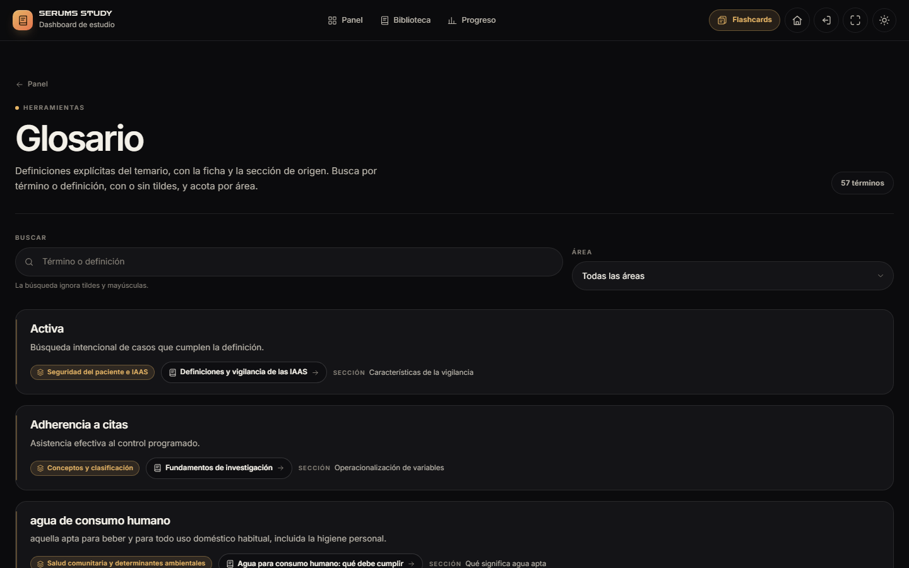
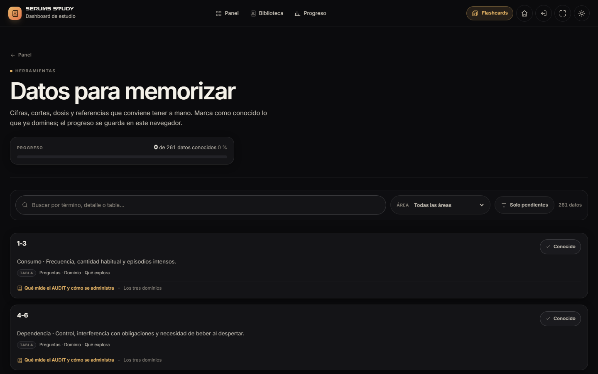
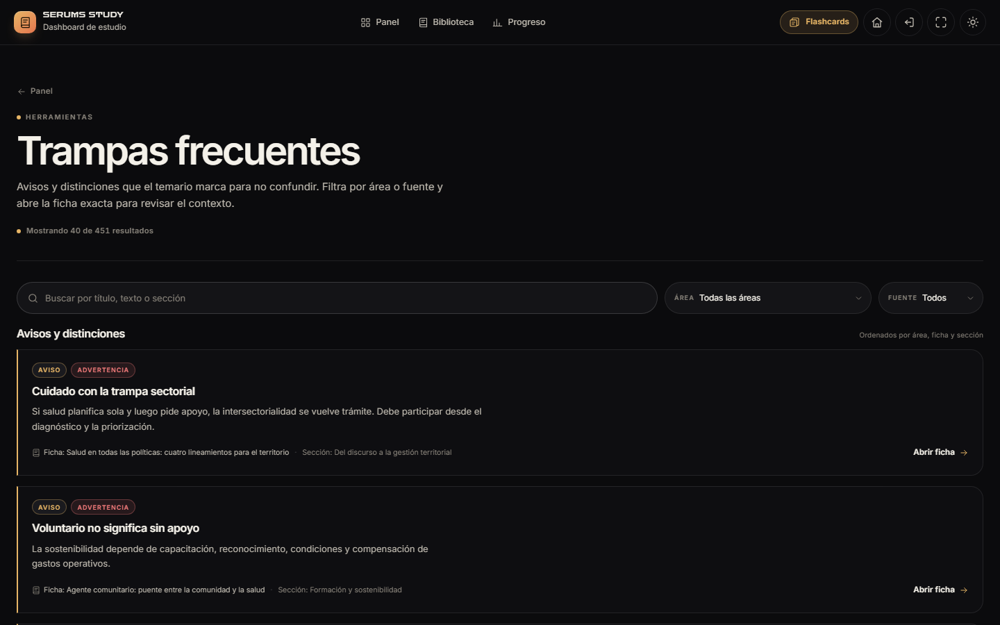
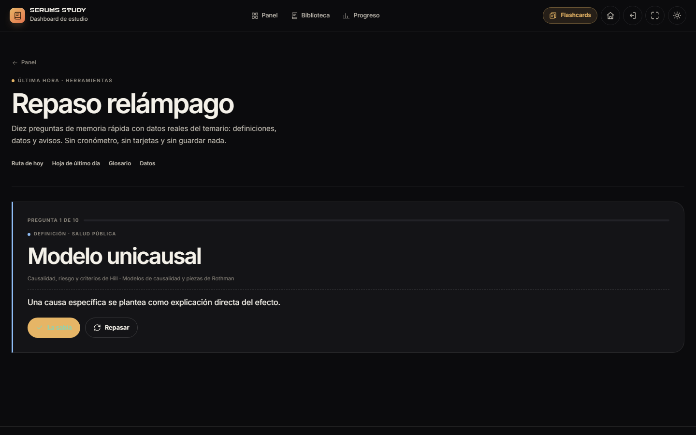
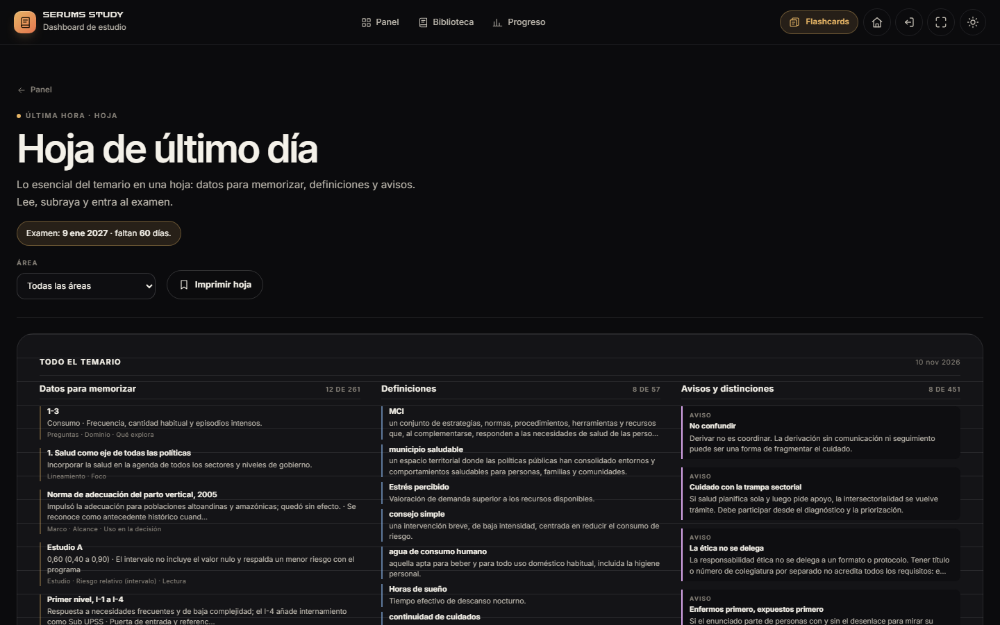

# Study Dashboard 2.3.0 · Fase 3 — Última hora

**Proyecto:** SERUMS STUDY · ZARCONT  
**Fecha:** 10 de noviembre de 2026 · America/Lima  
**Versión:** 2.3.0  
**Estado:** Fase 3 terminada y detenida a la espera de aprobación. **No se inició la Fase 4.**  
**Contrato:** `docs/CONTRATOS-FASE3.md` · **Datos:** `study-data/derived/`.

---

## 1. Resultado

La última hora del estudio ya está en la app: glosario, datos, trampas, repaso relámpago y hoja de último día. Los índices derivados no se descargan al arrancar; cada herramienta pide únicamente los datos que necesita al abrirse.

| Comprobación | Resultado |
|---|---:|
| E2E Study `DASH-01…44` + `FLASH-01…09` | **53/53 PASS** · 0 FAIL · 0 SKIP · `stable:true` |
| axe-core | **120 auditorías · 0 violaciones · 0 pendientes** · 12 estados |
| Contraste de tokens | **100 comprobaciones · 0 requeridas fallan** |
| Capturas | **258 PNG** · 6 viewports · 18 estados · 0 overflow |
| Carga inicial | **3.953,1 KB / 48 peticiones**; Fase 2: 3.730,8 KB; delta Fase 3: **+222,3 KB** |
| Derivados al arrancar | **0** · glosario/datos/trampas a 1 petición cada uno solo en su ruta |
| `plan-model.js` | 0 peticiones al arrancar; 1 al abrir `#/ruta` |

La evidencia E2E definitiva es `AUDIT/evidencias/phase3-release2/run-quick.json`: 53/53 con `stable:true`.

---

## 2. Qué se construyó

### 2.1 Glosario global · `#/glosario`

- 57 definiciones explícitas del derivado, sin definiciones inferidas.
- Búsqueda sin acentos, filtro por las cinco áreas oficiales, contador en vivo y orden alfabético español.
- Fuente visible: ficha, categoría y sección; enlace a la ficha.
- Estados de carga, error con reintento y vacío con limpieza de filtros.
- No usa el popover del lector: es la vista global consultable.

### 2.2 Datos para memorizar · `#/datos`

- 261 datos de tabla con término, detalle, encabezados, ficha y sección.
- Búsqueda, área y filtro «Solo pendientes».
- Progreso global sobre los 261 datos, no sobre el resultado filtrado.
- Marcar/desmarcar con `StudyStore.factsKnown.set`; persiste tras refrescar y no toca Flashcards ni las cajas de repaso.
- Si `factsKnown` no está disponible, el control se desactiva y se explica.

### 2.3 Trampas frecuentes · `#/trampas`

- 451 avisos y distinciones reales del derivado.
- Filtros por área y fuente: **Aviso** (callout) y **Distinción** (bullet); las 12 entradas `text` se muestran como «Referencia» solo en «Todos».
- Búsqueda sin acentos, contador de resultados y paginación 40 + 40.
- Enlace a la ficha y a la sección de origen.
- Estados de carga, error, vacío y limpieza de filtros.

### 2.4 Repaso relámpago · `#/relampago`

- Carga los tres derivados solo al montar la vista.
- Ronda de 10 preguntas reales: 4 datos, 3 definiciones y 3 avisos; sin preguntas inventadas ni repetidas.
- Revelar, «La sabía» / «Repasar», progreso, puntuación final y reinicio.
- Sin cronómetro, sin persistencia de la ronda y sin tocar Study Flashcards.

### 2.5 Hoja de último día · `#/ultimo-dia`

- Tres bloques compactos: datos, definiciones y avisos/distinciones con reparto por área.
- Fecha de examen y días restantes desde `StudyStore.plan.get()` si existe; enlace a `#/plan` cuando falta.
- Filtro por área y botón de impresión (`window.print`).
- Impresión A4 en una página: oculta appbar, footer y toolbar; la hoja conserva tres columnas.

### 2.6 Navegación y datos

- **Más → Última hora** con las cinco rutas; la appbar móvil sigue con cinco controles.
- Paleta Ctrl+K con **15 vistas**; `#/ruta` incorpora la franja «Antes del examen» con relámpago y hoja.
- `StudyReference` centraliza carga perezosa, normalización, áreas, filtros y `setKnown`; no registra rutas ni escribe fuera de `factsKnown`.
- `#/glosario`, `#/datos` y `#/trampas` comparten la misma semántica de búsqueda y estados.

---

## 3. Capturas

La galería completa está en `tools/qa/salida/capturas/` (258 PNG) y la selección publicada en [`capturas/`](capturas/).











- [Glosario con búsqueda](capturas/glosario-busqueda-oscuro-1440x900.png)
- [Datos con pendientes](capturas/datos-pendientes-oscuro-1440x900.png)
- [Trampas con segunda página](capturas/trampas-mas-oscuro-1440x900.png)
- [Más → Última hora](capturas/mas-ultima-hora-oscuro-390x844.png)

---

## 4. Verificación

```powershell
node --test "study-dashboard/tests/unit/plan/**/*.test.mjs"  # 118/118
node --test "study-dashboard/tests/data/**/*.test.js"       # 29/29
node tools/qa/run-qa.mjs                                    # 4/4 bloques
node tests/e2e/run.mjs --suite=dash,flash --quick           # 53/53
```

- **DASH-39…44:** carga perezosa de cada derivado; glosario; datos y `factsKnown`; trampas y fuentes; relámpago; hoja; descubrimiento y 6 viewports.
- **axe:** 120 auditorías en 15 rutas, 2 temas, 2 viewports y 12 estados abiertos; 0 violaciones.
- **Contraste:** 100 comprobaciones de tokens, 0 requeridas fallan; los avisos decorativos siguen igual que en fases anteriores.
- **Regresión:** las 47 pruebas anteriores y las 9 de Flashcards siguen verdes.
- **Datos:** 0 derivados al arrancar; `glossary.json`, `facts.json` y `warnings.json` solo se solicitan en su herramienta.

### Evidencias

- [`evidencias/e2e-run-quick.json`](evidencias/e2e-run-quick.json) y [`run-meta.json`](evidencias/run-meta.json) — E2E final.
- [`evidencias/axe.json`](evidencias/axe.json) — matriz axe.
- [`evidencias/peso.json`](evidencias/peso.json) — carga inicial y derivados bajo demanda.
- [`evidencias/capturas.json`](evidencias/capturas.json) — 258 capturas.
- [`ANEXO-QA.md`](ANEXO-QA.md) — resumen de QA.
- [Contrato de Fase 3](../../docs/CONTRATOS-FASE3.md).

---

## 5. Rendimiento

| Medida | Valor |
|---|---:|
| Fase 3 (portada) | **3.953,1 KB / 48 peticiones** |
| Fase 2 | 3.730,8 KB / 37 |
| Fase 1 | 3.442,6 KB / 28 |
| Fase 0 | 2.903,5 KB / 13 |
| Delta de Fase 3 | **+222,3 KB** |
| Derivados al arrancar | **0** |
| `glossary.json` en `#/glosario` | 1 petición |
| `facts.json` en `#/datos` | 1 petición |
| `warnings.json` en `#/trampas` | 1 petición |
| Los tres en relámpago/hoja | 3 peticiones al abrir |

El temario compartido no cambió. **H4 sigue abierto:** no se dividió la carga inicial del temario. El aumento de código/CSS se mide y se informa; los datos derivados siguen fuera del arranque.

---

## 6. Límites y decisiones

- El glosario enlaza a la ficha, no a `#section-N`: el router actual no acepta anclas de sección.
- La hoja de último día usa `@media print` con selectores globales **solo dentro de impresión** para ocultar appbar/footer; está documentado en el CSS.
- Hay 12 avisos con `source:"text"` en el derivado; se muestran como «Referencia» en «Todos» y no se añadió una cuarta opción de filtro fuera del contrato.
- Los filtros de las herramientas no se persisten; el router conserva el scroll al volver.
- El repaso relámpago no guarda puntuación ni modifica `factsKnown`; es una ronda de memoria, no una evaluación persistente.
- Revisión humana con NVDA/VoiceOver y hardware iOS/Android pendiente.
- Fase 4 no iniciada.

---

## 7. Estado de entrega

La Fase 3 queda terminada y **detenida a la espera de aprobación**. Las cinco herramientas están integradas, son descubribles desde Más, la paleta y la Ruta de hoy, y no hay datos inventados ni dependencias nuevas.

© 2026 ZARCONT — Documento interno del proyecto.
