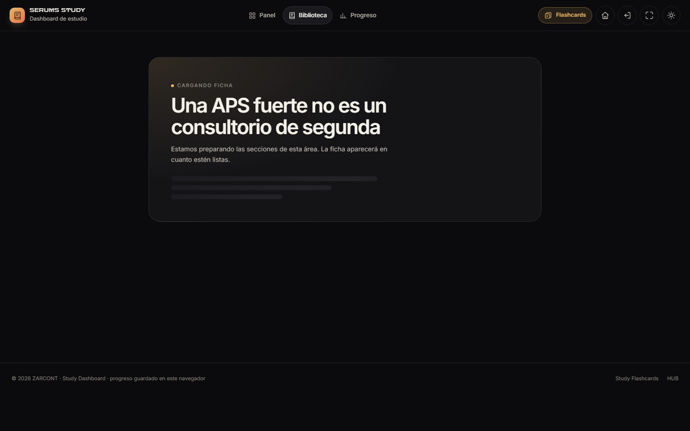
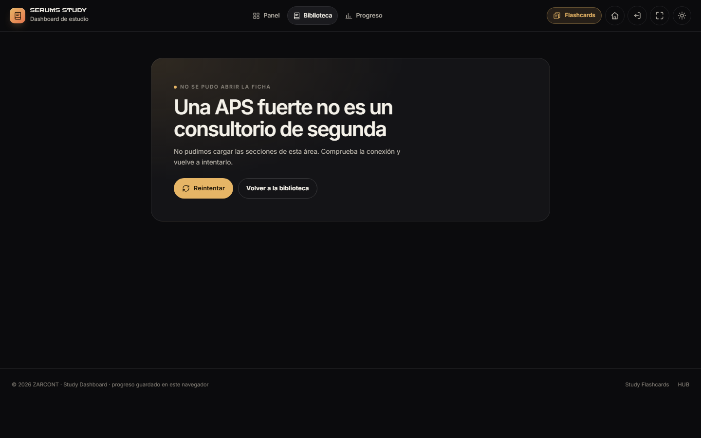
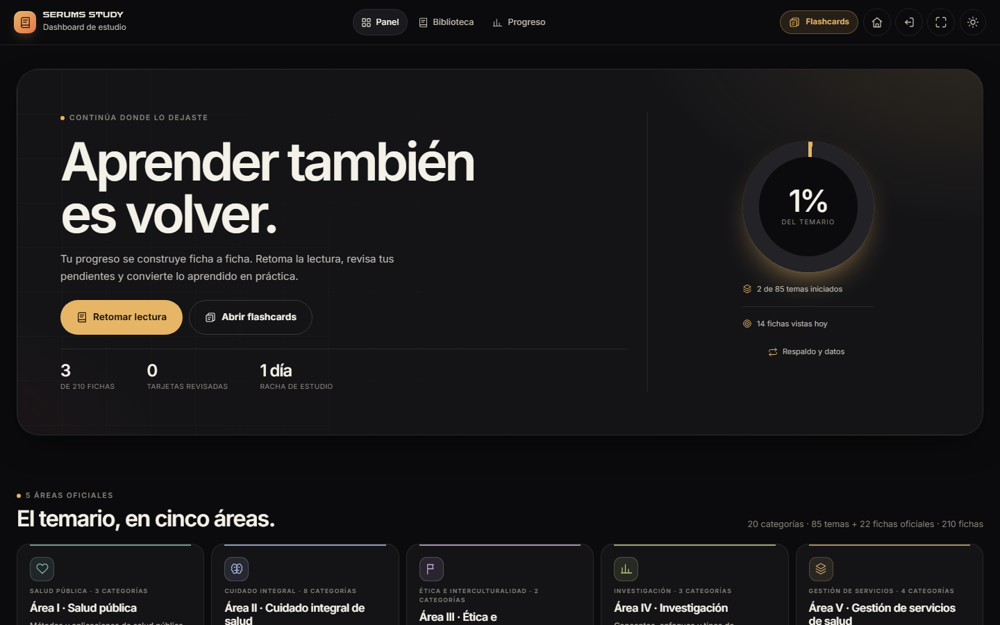

# Study Dashboard 2.3.0 · Fase 4 — Carga inicial y cierre editorial

**Proyecto:** SERUMS STUDY · ZARCONT  
**Fecha:** 10 de noviembre de 2026 · America/Lima  
**Versión:** 2.3.0  
**Estado:** Fase 4 terminada y detenida a la espera de aprobación. **No se inició la Fase 5.**  
**Contrato:** `docs/CONTRATOS-FASE4.md`  
**Base:** `informe/fase3/INFORME-FASE3.md` e informe editorial H17/H18.

---

## 1. Resultado

| Comprobación | Resultado |
|---|---:|
| Matriz E2E DASH-01…48 + FLASH-01…09 + HUB + F4 | **74/74 PASS** · `stable:true` |
| Pruebas de datos `tests/data` | **36/36 PASS** |
| axe-core | **128 auditorías · 0 violaciones · 0 pendientes** |
| Contraste de tokens medido en página | **1.042 comprobaciones · 0 fallos requeridos** |
| Capturas | **290 PNG** · 22 estados · 6 viewports · 0 problemas |
| Dashboard inicial | **3.959,6 KB → 2.263,3 KB** · **−42,8 %** |
| Study Flashcards inicial | **2.832,3 KB → 1.128,3 KB** · **−60,2 %** |
| HUB | **11 KB → 11 KB** · sin `study-data` |
| Core + loader | **830,9 KB** · 210 fichas y 630 tarjetas de metadatos |
| Primera área bajo demanda | **524,3 KB** · 2 secciones de Cuidado integral |
| Integridad | **1.256+ archivos** al cierre, 0 diferencias |

La app ya no descarga el temario completo al arrancar. El núcleo (metadatos y tarjetas) llega en una sola petición; las secciones se piden por área al abrir una ficha.

---

## 2. H4 · qué cambió

### 2.1 División del contenido

La fuente canónica sigue siendo `study-data/temario.js` (2.587.623 B), intacta y usada por generadores, pruebas y herramientas internas. La app usa una versión generada:

| Archivo | Tamaño | Contenido |
|---|---:|---|
| `study-data/temario-core.js` | 842.784 B | 210 fichas sin `sections`, 630 cards, 48 fuentes, 23 áreas, 86 temas |
| `study-data/sections/area-psi-cuidado-integral.js` | 536.556 B | 135 fichas / 670 secciones |
| `study-data/sections/area-psi-salud-publica.js` | 343.858 B | 43 fichas / 375 secciones |
| `study-data/sections/area-psi-gestion.js` | 163.366 B | 16 fichas / 171 secciones |
| `study-data/sections/area-psi-etica.js` | 101.327 B | 9 fichas / 96 secciones |
| `study-data/sections/area-psi-investigacion.js` | 70.256 B | 7 fichas / 80 secciones |
| `study-data/content-split.json` | 2.735 B | conteos, hashes y cobertura |

- **210/210 fichas** cubiertas; **1.392/1.392 secciones**; 5 áreas; 0 duplicados y 0 ausentes.
- `tools/build-content-split.js` es determinista y genera core, chunks y manifiesto desde el temario + taxonomía.
- `study-data/content-loader.js` expone `ensureSheet`, `loadArea` y `needs`; no pide nada al evaluarse; cachea por área; reintenta con `&retry=N`; falla de forma recuperable.
- El núcleo conserva **cards** y todos los metadatos: Study Flashcards sigue con 630 tarjetas, no necesita loader ni chunks.
- El HUB no carga temario ni cambia el snapshot `studyhub:snapshot:v1`.

### 2.2 Carga bajo demanda en el Dashboard

- `index.html` carga `temario-core.js` + `content-loader.js`; no carga `temario.js`.
- Al abrir una ficha sin secciones, `app.js`:
  1. registra la vista una sola vez;
  2. pinta un estado `role="status"` con `aria-busy="true"` y esqueleto;
  3. pide solo el chunk del área;
  4. re-renderiza el lector si la ruta sigue siendo la misma;
  5. si falla, muestra `role="alert"` y **Reintentar**; el reintento vuelve a pedir `&retry=N`.
- Una segunda ficha de la misma área no repite la petición; otra área pide su propio chunk.
- Si se navega mientras carga, la respuesta se ignora y no se monta un lector vacío.
- Panel, Biblioteca, Progreso, Plan, Glosario, Datos, Trampas, Relámpago y Último día no piden chunks.

### 2.3 Peso por aplicación

Medición real con Chrome headless, caché desactivada y `transferSize`; línea base reconstruida bloqueando los assets de contenido y sumando el temario completo real (2.527,3 KB).

| App | Antes | Después | Delta |
|---|---:|---:|---:|
| Study Dashboard | 3.959,6 KB | 2.263,3 KB | **−1.696,3 KB (−42,8 %)** |
| Study Flashcards | 2.832,3 KB | 1.128,3 KB | **−1.703,9 KB (−60,2 %)** |
| HUB | 11 KB | 11 KB | 0 |

El coste aplazado es explícito: al abrir la primera ficha de Cuidado integral se piden 524,3 KB (963 ms en local) y el resto de áreas permanece sin descargar.







---

## 3. Cero pérdida y apps intactas

| Garantía | Evidencia |
|---|---|
| Progreso, subrayados, notas, dudas y plan | DASH-48 importa un estado v2 y comprueba conservación; DASH-06/19/20/33 siguen verdes |
| `cards` / `flashSession` | FLASH-01…09 y F4-FLASH verdes; sin cambios de lógica en Flashcards |
| `studyhub:snapshot:v1` | F4-HUB: clave, formato y lectura intactos; HUB sin peticiones a `study-data/`; tarjeta «Continuar» y progreso 1/210 |
| IDs y contenido | Core mantiene los mismos IDs, títulos, cards, fuentes y metadatos; `temario.js` no se modificó (hash `CC9A…C15A`) |
| Canon técnico | `build-derived`, tests y previews siguen usando el archivo completo de 2.5.0 |

No se cambió el esquema del store ni se migraron datos.

---

## 4. H17 · conteo editorial

- Conteo verificado: **48 fuentes · 86 registros de tema · 1 contenedor (`topic-psi-ci-2`) · 85 temas con contenido · 22 fichas oficiales · 210 fichas · 630 tarjetas**.
- La biblioteca muestra **107 entradas** (85 bloques + 22 fichas oficiales), no 86 módulos.
- Producto corregido:
  - Panel: «85 temas + 22 fichas oficiales · 210 fichas».
  - Biblioteca y cabecera de área: 85 temas + 22 oficiales.
  - HUB: «210 fichas · 85 temas · 22 fichas oficiales · 5 áreas».
  - `StudyStore.getDashboardStats().totalTopics` = 85; `totalOfficialSheets` = 22.
  - `compileAreaStats` y recomendaciones excluyen el contenedor.
- El dato canónico conserva 86 registros de tema; no se alteró contenido para «cuadrar» el número.

Detalle y ubicaciones: [`docs/INFORME-EDITORIAL-H17-H18.md`](../../docs/INFORME-EDITORIAL-H17-H18.md).

## 5. H18 · fuentes declaradas sin cita

- 48 fuentes declaradas; 46 con `sourceRefs`; 254 referencias; 210/210 fichas con al menos una.
- Las dos no citadas en fichas son estructurales/antecedente:
  - `src-psico-temario`: temario oficial de Psicología SERUMS 2026-II, 3 pp.; define temas y subtemas, no desarrolla contenido.
  - `src-nutricion-ninos-anterior`: acto resolutivo de la guía anterior; su contenido temático se desarrolla en la guía 2025.
- **No se añadieron citas ni contenido clínico inventado.** Se documentan como fuentes de estructura/antecedente en la sección [H18: observación editorial](../../docs/INFORME-EDITORIAL-H17-H18.md#h18-observacion-editorial).

---

## 6. Pruebas y evidencias

```powershell
node --test "study-dashboard/tests/data/**/*.test.js"   # 36/36
node tests/e2e/run.mjs --suite=fase4                    # 74/74
node tools/qa/run-qa.mjs                                # axe + contraste + peso + capturas
```

- **DASH-45:** core + loader, sin `temario.js`; 210/630/48; Panel/Biblioteca/Progreso sin chunks.
- **DASH-46:** ficha directa con chunk retenido y fallido: loading accesible, error, Reintentar, lector, misma área sin repetir, otra área, cancelación y 0 temario completo.
- **DASH-47:** H17 visible y H17 sin «86 módulos».
- **DASH-48:** cero pérdida de un estado v2.
- **F4-FLASH / F4-HUB:** Flashcards y snapshot del HUB.
- Regresión: DASH-01…44, FLASH-01…09 y HUB-01…15 verdes; el snapshot y la lectura del HUB quedaron intactos.

### Evidencias

- [`evidencias/e2e-run.json`](evidencias/e2e-run.json) y [`run-meta.json`](evidencias/run-meta.json)
- [`evidencias/peso-apps.json`](evidencias/peso-apps.json) y [`peso-apps.md`](evidencias/peso-apps.md)
- [`evidencias/axe.json`](evidencias/axe.json)
- [`evidencias/capturas.json`](evidencias/capturas.json)
- [`evidencias/content-split.json`](evidencias/content-split.json)
- [`ANEXO-QA.md`](ANEXO-QA.md) · [informe editorial H17/H18](../../docs/INFORME-EDITORIAL-H17-H18.md)

---

## 7. Límites y decisiones

- El core aún incluye las **630 tarjetas** (830,9 KB). Dividirlas queda para una fase posterior; la reducción actual ya es de 42,8 %/60,2 % en el arranque.
- La primera ficha de Cuidado integral pesa 524,3 KB; es el área más grande. No se precargan áreas para no perder la ventaja del arranque.
- El HUB no descarga temario: su peso no cambia (11 KB).
- H17 deja 86 registros de tema como dato canónico; el copy visible usa 85 temas + 22 oficiales.
- H18 queda documentado, no convertido en citas inexistentes.
- Revisión humana con NVDA/VoiceOver, iOS/Android físico y prueba de red real siguen pendientes.
- No se inició la Fase 5.

---

## 8. Estado de entrega

H4 y el cierre editorial H17/H18 quedan terminados y **detenidos a la espera de aprobación**. La carga inicial bajó en las dos apps, ningún dato guardado se perdió y el HUB siguió leyendo su snapshot sin cambios.

© 2026 ZARCONT — Documento interno del proyecto.
